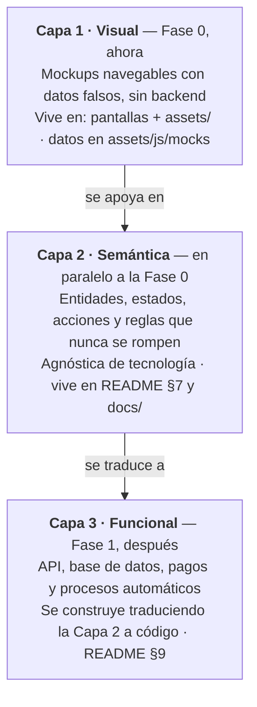
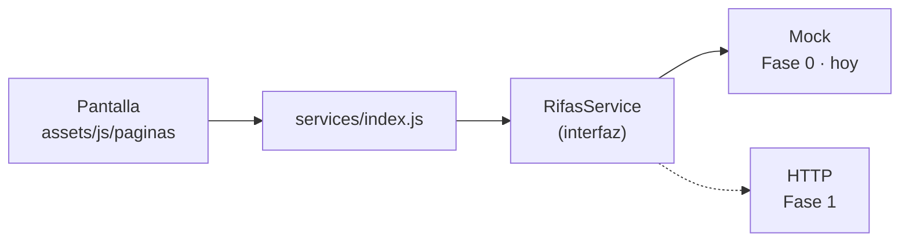
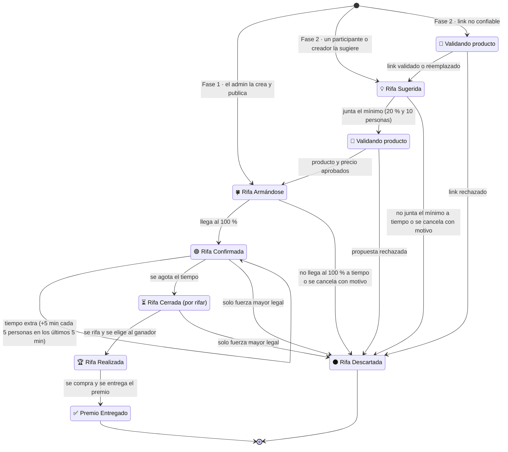
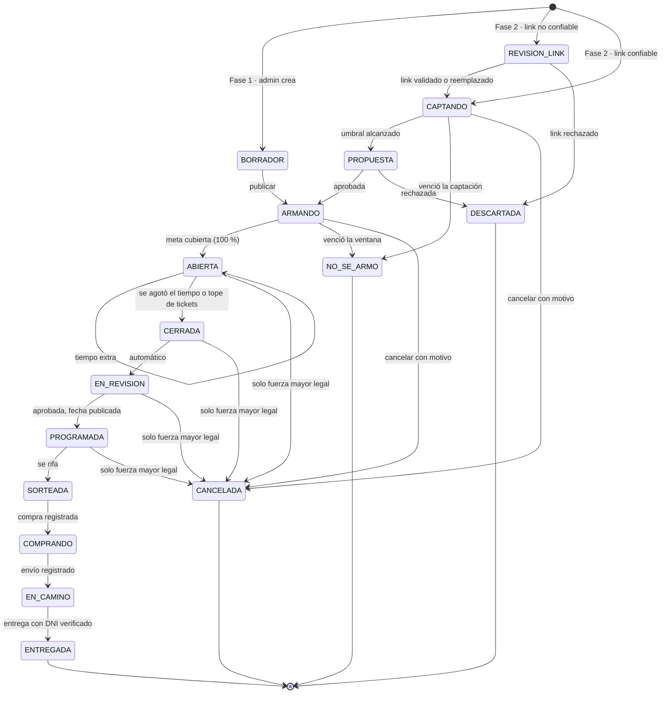
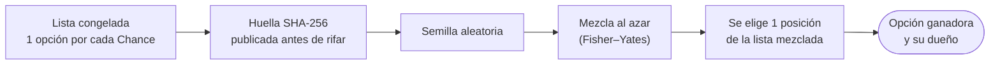
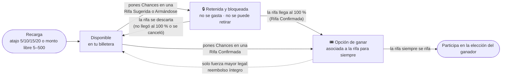
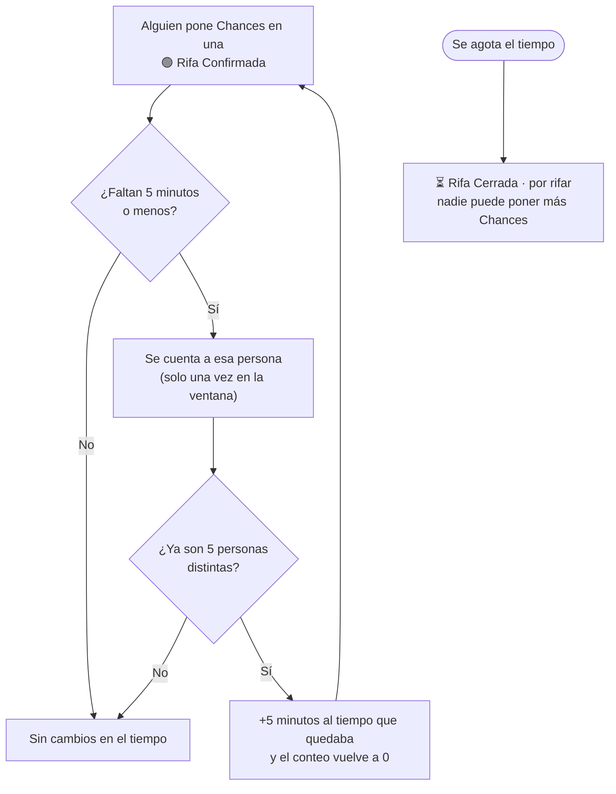
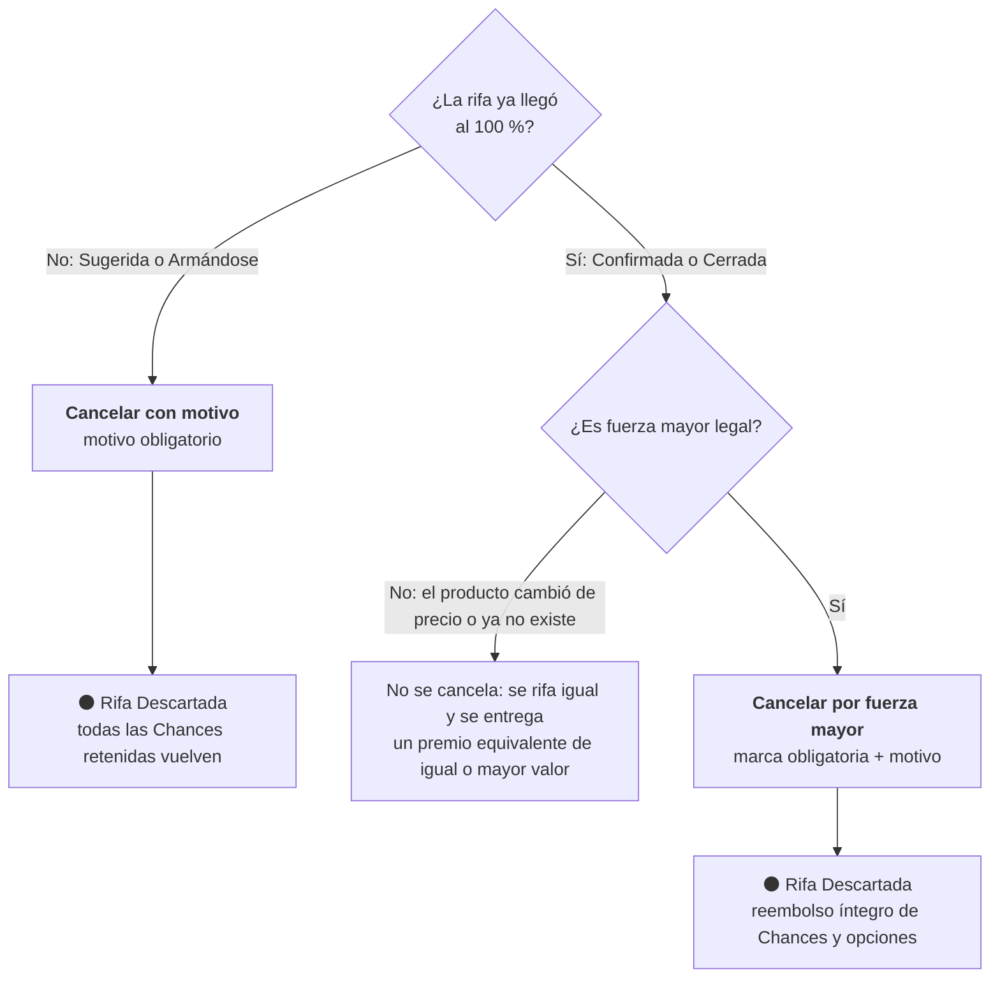
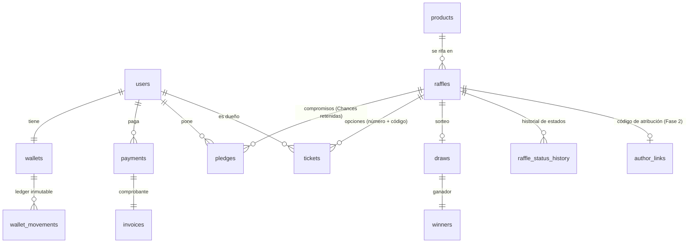

# Rifas-project — Plataforma de Rifas a Demanda

> **Estado del proyecto:** 🟡 Fase 0 · Mockups (en desarrollo inicial)
> **Mercado:** Perú · **Moneda:** Soles (S/)
> **Este documento es la introducción oficial del repositorio.** Explica qué estamos construyendo, cómo se trabaja en esta etapa y dónde vive cada definición.
>
> 📄 **[Propuesta del proyecto](docs/propuesta.md)** — resumen de negocio para socios e inversionistas.
> 📍 **[Bitácora (PROGRESO)](docs/PROGRESO.md)** — en qué paso estamos, qué sigue y decisiones tomadas.
> 🗺️ **Diagramas:** [flujo de trabajo](docs/diagramas/flujo-de-trabajo.md) · [ciclo de vida de una rifa](docs/diagramas/ciclo-de-vida-rifa.md) · [billetera](docs/diagramas/flujo-billetera.md) · [recorrido del usuario](docs/diagramas/recorrido-usuario.md) · [arquitectura](docs/diagramas/arquitectura.md)

---

## Índice

1. [Qué es este proyecto](#1-qué-es-este-proyecto)
2. [Estado actual del repositorio](#2-estado-actual-del-repositorio)
3. [Cómo trabajamos: tres capas](#3-cómo-trabajamos-tres-capas)
4. [Instrucciones de desarrollo para la Fase 0 (mockups)](#4-instrucciones-de-desarrollo-para-la-fase-0-mockups)
5. [Estructura del repositorio](#5-estructura-del-repositorio)
6. [Inventario de pantallas a maquetar](#6-inventario-de-pantallas-a-maquetar)
7. [Semántica funcional (definición abstracta)](#7-semántica-funcional-definición-abstracta)
8. [Datos de ejemplo para los mockups](#8-datos-de-ejemplo-para-los-mockups)
9. [Referencia técnica para la fase funcional](#9-referencia-técnica-para-la-fase-funcional)
10. [Cumplimiento legal](#10-cumplimiento-legal)
11. [Roadmap](#11-roadmap)
12. [Convenciones del equipo](#12-convenciones-del-equipo)
13. [Decisiones pendientes](#13-decisiones-pendientes)

---

## 1. Qué es este proyecto

Plataforma web donde los usuarios se registran con su **DNI**, **recargan saldo en puntos** y usan esos puntos para **comprar opciones (tickets) en rifas de productos**.

- **1 punto = S/ 1.00 = 1 opción** en una rifa. En pantalla, el punto se llama **Chance** ("1 Chance = S/ 1 = 1 opción de ganar").
- Recargas: atajos rápidos de **5, 10, 15 y 20 Chances** o un **monto libre de 5 a 500 Chances** por recarga (límites configurables por un admin, §7.9).
- Cada rifa nace como una **intención**: muestra la foto del producto, su **precio referencial** (según el link de la tienda) y cuánta gente ya participa.
- Cada rifa tiene una **meta** = precio del producto + **margen interno** de la plataforma. El margen nunca se muestra al público.
- **Ciclo de vida visible** (detalle en §7.4 y §7.13): **Rifa Sugerida** *(Fase 2, solo por enlace)* → **Rifa Armándose** (menos del 100 %) → **Rifa Confirmada** (llegó al 100 %) → **Rifa Cerrada** (por rifar) → **Rifa Realizada** (ya hay ganador) → **Premio Entregado**. Si no llega al 100 % a tiempo, **Rifa Descartada**.
- Las Chances que se ponen mientras la rifa no llega al 100 % quedan **retenidas y bloqueadas**: no se gastan y **no se pueden retirar**. Si la rifa se descarta, vuelven todas; si llega al 100 %, se convierten en **opciones de ganar** y quedan asociadas a la rifa para siempre.
- Una **Rifa Confirmada** sigue abierta un tiempo para que más personas se unan, con **tiempo extra**: si faltan 5 minutos o menos, cada 5 personas distintas que pongan Chances suman 5 minutos. Al agotarse el tiempo pasa a **Rifa Cerrada**.
- **Una Rifa Confirmada siempre se rifa.** Si el producto cambió de precio o ya no existe, se entrega uno equivalente de igual o mayor valor. Solo se cancela por fuerza mayor legal, con reembolso total.
- Después de cerrar, el equipo **valida** que todo esté en orden, anuncia la fecha, **se rifa en vivo** (Rifa Realizada), **compra** el premio a nombre del ganador fuera de la web y lo **entrega** (Premio Entregado).
- Cada rifa tiene un **enlace público compartible**: cualquiera puede verla sin iniciar sesión; el login se pide recién al momento de poner puntos.

### Fases de negocio

| Fase | Quién crea las rifas |
|------|----------------------|
| **Fase 1** | Solo los administradores. |
| **Fase 2** | Cualquier participante o **creador de contenido** puede proponer una rifa (link del producto, foto, precio). La propuesta nace **privada, solo accesible por su enlace**, y su autor debe juntar un apoyo mínimo real (puntos puestos) antes de que la rifa aparezca en el listado público. |

El motor de rifas es **el mismo** en ambas fases; la Fase 2 solo agrega la etapa privada de captación (**Rifa Sugerida**) y la moderación.

> **Por qué la etapa privada:** si cualquiera pudiera publicar rifas directamente en el listado, se llenaría de miles de rifas que nunca se arman. Exigir que el autor junte primero un apoyo mínimo con su propia comunidad filtra las propuestas sin tracción y premia a quien tiene audiencia (por eso los creadores de contenido tienen ventaja).

---

## 2. Estado actual del repositorio

Ya existen en el repositorio, como mockup (solo interfaz, sin lógica):

| Pantalla | Estado | Rol en el proyecto |
|----------|--------|--------------------|
| Página de inicio (`index.html`) | ✅ Mockup construido | **Referencia visual principal** |
| Inicio de sesión (`iniciar-sesion.html`) | ✅ Mockup construido | Referencia de formularios |
| Creación de cuenta (`crear-cuenta.html`) | ✅ Mockup construido | Referencia de formularios multi-campo |

Stack actual: **HTML, CSS y JavaScript estáticos**, sin framework.

> **Regla de oro:** estas tres pantallas son la **fuente de verdad visual** del proyecto. Todo mockup nuevo debe verse como si lo hubiera diseñado la misma persona, el mismo día.

### Archivos para trabajar con Claude Code

| Archivo | Para qué sirve |
|---------|----------------|
| `CLAUDE.md` | Reglas del proyecto. Claude Code lo carga solo en cada sesión. |
| `README.md` | Este documento: especificación funcional completa (qué se construye y cómo funciona). |
| `PROMPT-FASE0.md` | Plan paso a paso para que Claude Code construya todos los mockups conectados. |
| `docs/PROGRESO.md` | Bitácora compartida del equipo: paso actual, hecho, pendiente y decisiones. Se lee al empezar y se actualiza al terminar cada paso. |
| `docs/diagramas/` | Diagramas en Mermaid (ciclo de vida, opciones y transparencia, billetera, recorrido, mapa de pantallas, arquitectura). Índice y cómo verlos en [`docs/diagramas/README.md`](docs/diagramas/README.md). En VS Code: extensión **Markdown Preview Mermaid Support** (recomendada en `.vscode/extensions.json`) y `Ctrl+Shift+V`. |

Para empezar, en la terminal del proyecto: `claude` y luego
`Lee CLAUDE.md, README.md y PROMPT-FASE0.md. Ejecuta el Paso 0 y espera mi aprobación.`

---

## 3. Cómo trabajamos: tres capas

El proyecto avanza separando **cómo se ve**, **qué significa** y **cómo funciona**. Cada capa se completa sin depender de la siguiente.



**El puente entre capas son los servicios con interfaz.** En la Fase 0, cada pantalla obtiene sus datos de un servicio *mock* que respeta exactamente la misma interfaz que tendrá el servicio real. Cuando llegue la Fase 1, se cambia la implementación del servicio y las pantallas no se tocan.



---

## 4. Instrucciones de desarrollo para la Fase 0 (mockups)

> Estas instrucciones aplican a cualquier persona o agente de IA que construya pantallas en esta fase.

### 4.1 Antes de escribir código

1. **Revisa las tres pantallas existentes** (inicio, login, registro) y extrae de ellas:
   - Paleta de colores, tipografías, tamaños y pesos.
   - Espaciados, radios de borde, sombras.
   - Estilo de botones (primario, secundario, deshabilitado), inputs, mensajes de error, tarjetas.
   - Comportamiento responsive (cómo cambian en móvil).
2. **Consolida eso en tokens de diseño** (`src/styles/tokens`) si aún no existen. Ninguna pantalla nueva usa colores ni medidas "sueltas"; todo sale de los tokens.
3. **Extrae a `components/ui`** los elementos repetidos que ya existan en las pantallas actuales (botón, input, tarjeta, header, footer) antes de crear pantallas nuevas. No dupliques.
4. **Mantén el stack ya usado en el repositorio.** No cambies de framework, librería de estilos ni gestor de paquetes. Si algo falta (por ejemplo, un router), propón la alternativa en un PR aparte.

### 4.2 Qué SÍ se hace en la Fase 0

- Pantallas completas, navegables entre sí, con **datos falsos tipados** desde `src/mocks`.
- Todos los **estados visuales** de cada pantalla: cargando, vacío, error, éxito y los estados de negocio (por ejemplo, una rifa en cada uno de sus estados).
- Interacciones simuladas: un botón "Comprometer 5 opciones" actualiza el saldo mostrado **en memoria** y muestra el mensaje de éxito.
- Diseño **mobile-first** y accesible (contraste, `label` en inputs, foco visible, navegación con teclado).
- Textos en español de Perú, con el vocabulario del glosario (sección 7.1).

### 4.3 Qué NO se hace en la Fase 0

- No hay backend, base de datos, autenticación real ni pagos reales.
- No se llama a ninguna API externa (RENIEC, pasarelas, Random.org).
- No se escribe lógica de negocio dentro de componentes visuales: si una regla aparece (por ejemplo, "no se puede comprometer más del saldo disponible"), se implementa en el **servicio mock** y se documenta en `docs/semantica`.

### 4.4 Definición de "terminado" para una pantalla mockup

- [ ] Coincide visualmente con las pantallas de referencia (usa tokens y `components/ui`).
- [ ] Funciona en 360 px, 768 px y 1280 px de ancho.
- [ ] Muestra todos sus estados (ver inventario, sección 6).
- [ ] Consume datos solo a través de un servicio (`services/`), nunca importando el mock directamente en el componente.
- [ ] Los tipos de datos usados están en `src/domain` y coinciden con la semántica (sección 7).
- [ ] Tiene captura de pantalla (móvil y escritorio) en el PR.

---

## 5. Estructura del repositorio

Estructura propuesta. Las carpetas marcadas con *(Fase 1)* se crean cuando empiece la implementación funcional.

```
/
├── README.md                     ← este documento
├── CLAUDE.md                     ← reglas para Claude Code
├── PROMPT-FASE0.md               ← plan de construcción de mockups
├── docs/
│   ├── propuesta.md              ← propuesta de negocio (no técnica)
│   ├── PROGRESO.md               ← bitácora del equipo
│   ├── diagramas/                (Mermaid: flujo de trabajo, ciclo de vida, billetera, recorrido, arquitectura)
│   ├── semantica/                ← CAPA 2: definición abstracta
│   │   ├── 00-glosario.md
│   │   ├── 01-identidad.md       (usuario, registro, verificación)
│   │   ├── 02-billetera.md       (saldos, movimientos, invariantes)
│   │   ├── 03-rifas.md           (estados, transiciones, reglas)
│   │   ├── 04-sorteo.md          (snapshot, selección, ganador)
│   │   ├── 05-propuestas.md      (Fase 2: captación privada y moderación)
│   │   └── 06-administracion.md
│   ├── pantallas/
│   │   └── inventario.md         (lista de pantallas, estados, capturas)
│   ├── tecnica/                  ← CAPA 3: se completa en Fase 1
│   │   ├── modelo-datos.md
│   │   ├── contratos-api.md
│   │   └── procesos-automaticos.md
│   ├── legal/
│   │   └── cumplimiento.md
│   └── decisiones/               (ADR: un archivo por decisión importante)
│       └── 0001-billetera-con-ledger.md
│
├── web/                          ← CAPA 1: frontend (mockups ahora, real después)
│   ├── public/
│   └── src/
│       ├── app/ o pages/     rutas (según el framework actual)
│       ├── components/
│       │   ├── ui/           botón, input, tarjeta, modal, badge, barra de progreso
│       │   └── layout/       header, footer, contenedores, menú móvil
│       ├── features/         una carpeta por dominio
│       │   ├── auth/         login, registro, verificación
│       │   ├── billetera/    saldo, recarga, historial
│       │   ├── rifas/        listado, detalle, compromiso, compra
│       │   ├── sorteos/      ganadores, transparencia
│       │   ├── perfil/
│       │   ├── admin/
│       │   └── propuestas/   (Fase 2)
│       ├── domain/           tipos y enums derivados de docs/semantica
│       ├── services/
│       │   ├── interfaces/   contratos (RifasService, BilleteraService…)
│       │   ├── mock/         implementación Fase 0
│       │   └── http/         implementación Fase 1
│       ├── mocks/            datos falsos (JSON / TS)
│       ├── hooks/
│       ├── lib/              utilidades (formato de moneda, fechas)
│       └── styles/
│           └── tokens        colores, tipografía, espaciado
├── api/                          ← CAPA 3: backend (Fase 1)
│
└── .github/
    ├── pull_request_template.md
    └── ISSUE_TEMPLATE/
```

> **Fase 0 (estado actual):** el sitio es HTML, CSS y JavaScript estáticos y vive en la raíz del repositorio, con todo lo compartido en `assets/` (ver "Organización de carpetas" en `CLAUDE.md`).
> **Fase 1:** el frontend se moverá a `web/` y el backend irá en `api/`. Las pantallas no cambian: solo se reemplaza `services/mock` por `services/http`.

> Si el repositorio actual no es un monorepo, `web/src` equivale a la carpeta `src/` existente. No es obligatorio mover lo que ya está construido: basta con que lo nuevo siga esta organización y lo existente se migre gradualmente.

---

## 6. Inventario de pantallas a maquetar

**Prioridad:** P1 = necesaria para demostrar el flujo completo · P2 = complementaria · P3 = Fase 2.

### Públicas

| # | Pantalla | Ruta sugerida | Estados a mostrar | Prioridad |
|---|----------|---------------|-------------------|-----------|
| 1 | Inicio | `/` | ✅ existe | — |
| 2 | Listado de rifas | `/rifas` | Con resultados · vacío · filtro por estado · filtro por categoría | P1 |
| 3 | Detalle público de rifa (enlace compartible) | `/r/[slug]` | Una variante por estado (§7.4) · visitante sin sesión · botón "Comprar opciones" que lleva a login/registro y **regresa a la misma rifa** · botón compartir | P1 |
| 4 | Ganadores | `/ganadores` | Lista · vacío | P2 |
| 5 | Cómo funciona | `/como-funciona` | Explicación paso a paso de Chances, estados de la rifa y cómo se elige al ganador | P1 |
| 6 | Preguntas frecuentes | `/preguntas-frecuentes` | Acordeón | P2 |
| 7 | Términos, privacidad, reglamento | `/legal/*` | Texto largo | P2 |
| 8 | Libro de Reclamaciones | `/libro-de-reclamaciones` | Formulario · enviado | P2 |

### Autenticación

| # | Pantalla | Ruta sugerida | Estados | Prioridad |
|---|----------|---------------|---------|-----------|
| 9 | Inicio de sesión | `/login` | ✅ existe · agregar estado de error | — |
| 10 | Crear cuenta | `/registro` | ✅ existe · agregar errores por campo, DNI ya registrado, menor de edad | — |
| 11 | Verificar correo / celular | `/verificar` | Ingresar código · código incorrecto · reenviar | P1 |
| 12 | Recuperar contraseña | `/recuperar` | Solicitar · enlace enviado · nueva contraseña | P2 |

### Usuario (con sesión)

| # | Pantalla | Ruta sugerida | Estados | Prioridad |
|---|----------|---------------|---------|-----------|
| 13 | Mi billetera | `/billetera` | Saldo disponible + retenido (con detalle de en qué rifas está retenido) · sin movimientos | P1 |
| 13b | Mi historial de puntos | `/billetera/historial` | Lista de movimientos (recargas, puntos puestos, liberados, usados, reembolsos) · filtro por rifa y tipo · vacío | P1 |
| 14 | Recargar Chances | `/billetera/recargar` | Atajos 5/10/15/20 o monto libre de 5 a 500 (aviso junto al campo si sale del rango) · medio de pago · procesando · éxito · rechazado | P1 |
| 15 | Comprometer / comprar opciones | Modal desde detalle | Selector de cantidad · saldo insuficiente · confirmación · éxito | P1 |
| 16 | Mis rifas | `/mis-rifas` | Pestañas: Armando · Abiertas · Finalizadas · vacío | P1 |
| 17 | Mis tickets en una rifa | `/mis-rifas/[codigo]` | Opciones con número y código · Chances retenidas · descargar la lista pública (CSV) y verificar mis opciones | P2 (hecha) |
| 18 | Perfil | `/perfil` | Datos (DNI enmascarado) · editar apodo | P2 |
| 19 | Proponer rifa | `/crear-rifa` | Formulario: link del producto, foto/referencia, precio según la tienda, categoría · enviado | P3 |
| 20 | Mis rifas propuestas | `/mis-propuestas` | Calentando (privada, con enlace para compartir y avance hacia el umbral) · armando (pública) · no se armó · descartada | P3 |

### Administración

| # | Pantalla | Ruta sugerida | Estados | Prioridad |
|---|----------|---------------|---------|-----------|
| 21 | Dashboard | `/admin` | Recaudado · retenido total · rifas por estado | P2 |
| 22 | Productos | `/admin/productos` | Listado · crear/editar | P2 |
| 23 | Rifas | `/admin/rifas` | Listado por estado · crear · publicar · configuración por rifa (§7.9) | P1 |
| 24 | Cola de revisión | `/admin/revision` | Rifas cerradas por revisar · aprobar y anunciar la fecha en que se rifa · cancelar por fuerza mayor | P1 |
| 25 | Rifar (elegir ganador) | `/admin/rifas/[codigo]/sorteo` | Snapshot + hash · ejecutar · resultado | P2 |
| 25b | Compra y entrega | `/admin/rifas/[codigo]/entrega` | Registrar compra (datos y comprobante) · envío · entrega con DNI verificado y evidencia (§7.12) | P2 |
| 25c | Categorías | `/admin/categorias` | Listado · crear/editar | P2 |
| 26 | Usuarios | `/admin/usuarios` | Listado · detalle · ajuste de saldo con motivo | P2 |
| 27 | Moderar propuestas | `/admin/propuestas` | Propuestas que alcanzaron el umbral · aprobar (pasa a pública) · descartar con motivo · denuncias | P3 |

### Componente clave: tarjeta de rifa

Debe existir en `components/` con una variante visual por estado:

```
┌─────────────────────────────────────┐
│  [Foto del producto]                │
│  Consolas · PlayStation 5 Slim      │
│  Precio referencial: S/ 2,200       │
│  🍀 Rifa Armándose · quedan 4 d       │
│  👥 148 personas                    │
│  🟥🟧🟨🟩░░░░░░  65 %                 │
│  Tus Chances aquí: 10 (retenidas)   │
│  [ − ]  5  [ + ]   Poner Chances    │
│  Tus Chances quedan retenidas y     │
│  solo se usan si la rifa se arma.   │
│                       [Compartir ↗] │
│  ID: RF-7K3Q9XM2  (letra pequeña)   │
└─────────────────────────────────────┘
```

Reglas visuales de la tarjeta:
- **Foto del producto:** hasta **Rifa Armándose** se muestra **desenfocada** (token `--blur-fondo`); desde **Rifa Confirmada** en adelante, **nítida**. Las rifas descartadas la siguen mostrando desenfocada. Sin foto, se usa el ícono de la categoría con la misma regla.
- **Rifa Confirmada en Inicio:** la tarjeta agrega la cuenta regresiva (días, horas, min, seg) hasta el cierre, junto a la barra en 100 %. Inicio muestra primero **Rifas confirmadas** (las 3 que se cierran antes) y luego **Rifas armándose**, cada sección con su "Ver más…" hacia `/rifas` filtrado por estado.
- **Título** = nombre del producto obtenido automáticamente del link (ver §7.11).
- **Personas:** se muestra la cantidad de participantes ("148 personas"), **nunca** montos ni puntos reunidos, para no desanimar.
- **Barra de avance del pozo** en porcentaje (0–100 %), con color que pasa de **rojo** (inicio) a **verde** (100 %). Al llegar a 100 % pasa a **Rifa Confirmada**.
- **ID de rifa** alfanumérico visible en letra pequeña debajo de la tarjeta y en el detalle.

| Estado visible | Badge | Estados internos | Acción principal |
|----------------|-------|------------------|------------------|
| Rifa Sugerida *(F2)* | 💡 Rifa Sugerida · 🔒 solo por enlace | `CAPTANDO` | Poner Chances · compartir (no aparece en el portal ni en el buscador) |
| Validando producto *(F2)* | 🔎 Validando producto | `REVISION_LINK`, `PROPUESTA` | — (no recibe Chances nuevas) |
| Rifa Armándose | 🍀 Rifa Armándose | `ARMANDO` | Poner Chances (quedan bloqueadas: no se pueden retirar) |
| Rifa Confirmada | 🟢 Rifa Confirmada | `ABIERTA` | Poner Chances (compra directa de opciones) · tiempo extra (§7.13) |
| Rifa Cerrada | ⏳ Rifa Cerrada · Por rifar / 📅 Rifa Cerrada · se rifa el *fecha* | `CERRADA`, `EN_REVISION`, `PROGRAMADA` | Ver participantes · ver hash |
| Rifa Realizada | 🏆 Rifa Realizada · Ganador: *apodo* | `SORTEADA`, `COMPRANDO`, `EN_CAMINO` | Ver cómo se eligió al ganador (el seguimiento del premio muestra solo fechas) |
| Premio Entregado | ✅ Premio Entregado | `ENTREGADA` | — (muestra la fecha de entrega; la evidencia es interna) |
| Rifa Descartada | ⚫ Rifa Descartada | `NO_SE_ARMO`, `CANCELADA`, `DESCARTADA` | — (Chances devueltas) |

---

## 7. Semántica funcional (definición abstracta)

> Esta sección define **qué significa** cada cosa del sistema, sin hablar de tecnología. Es el contrato entre diseño, negocio y desarrollo. El detalle ampliado vive en `docs/semantica/`. Los tipos de `src/domain` deben reflejar exactamente lo que se define aquí.

### 7.1 Glosario

| Término | Significado |
|---------|-------------|
| **Visitante** | Persona sin sesión. Puede ver rifas y su información, pero no poner puntos. |
| **Participante** | Persona mayor de edad registrada con documento de identidad. |
| **Creador** *(Fase 2)* | Participante habilitado para proponer rifas y compartirlas con su comunidad. |
| **Administrador** | Persona del equipo que gestiona categorías, rifas, revisiones, rifas realizadas y entregas. |
| **Intención de rifa** | Rifa que aún no se confirma: está reuniendo puntos hacia su meta. |
| **Chance** | **Moneda visible** de la plataforma: 1 Chance = S/ 1 = 1 opción de ganar. Siempre en femenino: "la Chance", "35 Chances", "Tus Chances quedan retenidas". "Chance" se usa **solo** para la moneda. |
| **Rifa Armándose** | Nombre visible de la etapa en que una rifa pública junta Chances hacia su meta. |
| **Precio referencial** | Precio del producto según el link de la tienda. En pantalla: "Precio referencial: S/ X". |
| **Margen** | Monto interno que la plataforma suma al precio del producto para formar la meta. No es público. |
| **Enlace de rifa** | URL pública y compartible de una rifa (`/r/slug`). |
| **Categoría** | Agrupación de rifas: zapatillas, ropa, relojes, consolas, TVs, etc. |
| **Punto** | Nombre **interno** (código y especificación) de la Chance. 1 punto = S/ 1. En pantalla siempre se muestra como "Chance". |
| **Opción / ticket** | Una participación en una rifa. Cuesta 1 Chance: 10 Chances puestas = 10 opciones de ganar, cada una con su número. |
| **Rifa / sorteo** | **Rifa** es el hecho en general (la rifa se arma, se confirma, se cierra, se rifa). **Sorteo** es solo el acto técnico de elegir al ganador al azar entre todas las opciones (§7.8). En los textos visibles se dice "se rifa", **"Rifa en vivo"** o "cómo se eligió al ganador". |
| **Saldo disponible** | Puntos libres para usar. |
| **Saldo retenido** | Puntos comprometidos en rifas aún no confirmadas. Bloqueados pero no gastados. |
| **Compromiso** | Puntos que un participante pone en una rifa que aún se está armando. Quedan retenidos. |
| **Meta** | Número de opciones necesarias para confirmar una rifa = precio del producto + margen. |
| **Ventana de armado** | Plazo para alcanzar la meta. Por defecto 7 días. |
| **Captura** | Conversión de un compromiso en tickets reales; los puntos retenidos se consumen. |
| **Liberación** | Devolución de puntos retenidos al saldo disponible. |
| **Snapshot** | Lista congelada de todos los tickets de una rifa al cerrarse. |
| **Propuesta** *(Fase 2)* | Rifa creada por un participante o creador. |
| **Rifa Sugerida** *(Fase 2)* | Etapa privada de una propuesta: solo accesible por su enlace, no aparece en listados ni buscador. El autor capta apoyo con su comunidad. |
| **Umbral de visibilidad** *(Fase 2)* | Apoyo mínimo (puntos puestos y/o participantes) que una propuesta debe juntar en privado para pasar a la etapa pública de armado. |
| **Rifa no listada** | Rifa que existe y se puede abrir por enlace, pero no aparece en el listado general ni en el buscador. |
| **Clave de idempotencia** | Identificador único de cada intento de poner puntos o comprar; evita que un doble clic o un reintento descuente dos veces. |

### 7.2 Entidades

| Entidad | Atributos esenciales | Identificada por |
|---------|---------------------|------------------|
| **Participante** | documento, nombres, fecha de nacimiento, correo, celular, apodo público, estado | Documento (único) |
| **Billetera** | saldo disponible, saldo retenido | Pertenece a un participante (1 a 1) |
| **Movimiento** | tipo, variación en disponible, variación en retenido, referencia (rifa/pago/compromiso), fecha | Inmutable, nunca se edita ni se borra |
| **Paquete de recarga** | precio, puntos que otorga, activo (atajos rápidos: 5, 10, 15 y 20) | — |
| **Recarga** | paquete, monto, medio de pago, estado | Referencia de la pasarela (única) |
| **Categoría** | nombre, ícono, orden, activa | Nombre único |
| **Producto** | nombre (título extraído del link), imágenes, **descripción** (resumen tomado del link; empieza con el color o modelo específico; vacía si no se pudo leer), **link original**, **link de compra** (el que usa la plataforma, puede ser reemplazado por un admin), estado del link, precio según la tienda, categoría | — |
| **Tienda confiable** | dominio, nombre, activa | Dominio único. Lista que mantienen los admins |
| **Rifa** | producto, autor (admin, participante o creador), estado, meta, margen (interno), opciones comprometidas, opciones vendidas, número de participantes, configuración (§7.9), fechas | **Código** alfanumérico único y visible (ej. `RF-7K3Q9XM2`) + **slug** para su enlace |
| **Compromiso** | rifa, participante, cantidad de opciones, estado | — |
| **Ticket** | rifa, participante, número correlativo | Número único dentro de su rifa |
| **Sorteo** | rifa, snapshot, huella (hash), semilla, ticket ganador, posición en la lista mezclada | Uno por rifa |
| **Ganador** | sorteo, participante, estado de entrega, evidencia | — |
| **Enlace de autor** *(Fase 2)* | rifa, autor, código de atribución, visitas, registros y puntos generados | Código único |

### 7.3 Invariantes (reglas que nunca se rompen)

1. Un documento de identidad tiene **una sola** cuenta.
2. Solo participantes **mayores de 18 años** pueden registrarse.
3. El saldo disponible y el saldo retenido **nunca son negativos**.
4. El saldo de una billetera **siempre** es igual a la suma de sus movimientos. Ningún saldo se modifica sin un movimiento que lo explique.
5. Los movimientos son **inmutables**: un error se corrige con un movimiento compensatorio, no editando el original.
6. Un participante **no puede comprometer ni comprar** más opciones que su saldo disponible.
7. Cada ticket tiene un número **único** dentro de su rifa.
8. Una rifa solo se puede rifar (elegir ganador) **una vez**, y solo después de estar cerrada y con su snapshot publicado.
9. Si una rifa no se arma, se descarta o se cancela, **todos** los puntos retenidos o consumidos en ella vuelven a disponible.
10. Solo se aceptan puntos en rifas en estado **Captando** o **Armando** (como compromiso) o **Abierta** (como compra directa).
11. El premio solo se entrega al **titular del documento** de la cuenta ganadora.
12. El **margen**, la **meta** y los **puntos reunidos** de una rifa nunca se exponen al público ni en la API pública; el público solo ve la cantidad de personas y el porcentaje de avance.
13. Cualquier visitante puede **ver** una rifa por su enlace; solo un participante con sesión puede **poner puntos**.
14. Todo cambio de estado de una rifa queda registrado (quién, cuándo, por qué).
15. Si una rifa se cancela **después** de haber consumido puntos (solo posible por fuerza mayor legal, invariante 24), esos puntos se reembolsan íntegramente.
16. **Cada punto está en un solo lugar a la vez:** libre en la billetera, retenido en **una** rifa o consumido en **una** rifa. Nunca en dos.
17. El saldo retenido de un participante es **exactamente** la suma de sus compromisos activos en todas las rifas.
18. Una misma operación (identificada por su clave de idempotencia) se aplica **una sola vez**, aunque llegue repetida.
19. Una rifa en **Captando** nunca aparece en el listado general ni en el buscador; solo se accede por su enlace.
20. Toda rifa sorteada termina con la **entrega de un premio** al ganador: el producto indicado o uno equivalente de igual o mayor valor.
21. Una rifa con link en revisión **no acepta puntos**.
22. El código (ID) de cada rifa es único, no cambia nunca y no usa caracteres confusos (0/O, 1/I/L).
23. **Las Chances puestas quedan bloqueadas:** desde la Rifa Sugerida hasta que la rifa se confirma o se descarta, no se pueden retirar. Si la rifa no llega al 100 % (se descarta), vuelven todas; si llega, se vuelven opciones de ganar y quedan asociadas a la rifa para siempre.
24. **Una Rifa Confirmada siempre se rifa** con quienes pusieron sus Chances. Si el producto cambió de precio o ya no existe, se entrega uno equivalente de igual o mayor valor (§7.11). Solo se cancela por **fuerza mayor legal**, con reembolso total.

### 7.4 Ciclo de vida de una rifa

**Lo que ve el público** (estados visibles, §7.13). Diagramas completos en [`docs/diagramas/ciclo-de-vida-rifa.md`](docs/diagramas/ciclo-de-vida-rifa.md).



**Estados internos** (los que usa el sistema; cada uno se muestra con su estado visible):



| Estado | Etiqueta visible | Significado | ¿Acepta puntos? | Efecto en saldo |
|--------|------------------|-------------|-----------------|-----------------|
| `BORRADOR` | — | El admin la está configurando; no es pública. | No | — |
| `REVISION_LINK` *(F2)* | Validando producto | El link no es de tienda confiable o no se pudo leer; un admin lo valida o lo reemplaza (§7.11). | No | — |
| `CAPTANDO` *(F2)* | **Rifa Sugerida** 🔒 | Propuesta privada, no listada. Su autor comparte el enlace y la gente que entra pone puntos. Si alcanza el umbral de visibilidad pasa a moderación. | Sí, como compromiso | Disponible → Retenido |
| `PROPUESTA` *(F2)* | Validando producto | Alcanzó el umbral; el admin valida producto lícito, precio coherente con el link y entregable, y fija el margen. Sigue accesible por enlace pero ya no acepta puntos nuevos. | No | Se mantiene retenido |
| `ARMANDO` | **Estados visibles** | Lo que ve el público: **Rifa Sugerida** → **Rifa Armándose** → **Rifa Confirmada** → **Rifa Cerrada** (por rifar) → **Rifa Realizada** → **Premio Entregado**; o **Rifa Descartada**. Además, **Validando producto** es el estado de validez (link, existencia y precio del producto). Ver §7.13. |
| **Rifa Armándose** | Rifa visible en el portal que todavía no llega al 100 % de lo que necesita recaudar. |
| **Rifa Confirmada** | Rifa que llegó al 100 %: sigue abierta un tiempo (con tiempo extra al final) para que más personas se unan. |
| **Rifa Cerrada** | Se agotó el tiempo; nadie puede poner más Chances. Es una rifa **por rifar**. |
| **Rifa Realizada** | Ya se eligió al ganador. Sigue así mientras se compra y se envía el premio. |
| **Rifa Descartada** | No llegó al 100 % a tiempo, se canceló por cualquier motivo o su propuesta no pasó la validación. Todas las Chances vuelven. |
| **"Rifar"** | En los textos visibles no se usa "sortear" ni "sorteo": se dice "se rifa", "Rifa Realizada", "cómo se eligió al ganador". |
| `NO_SE_ARMO` | **Rifa Descartada** | La ventana venció sin cubrir la meta. | No | Retenido → Disponible |
| `ABIERTA` | **Rifa Confirmada** | Meta cubierta. Todos los compromisos se convierten en tickets. Sigue abierta para nuevos participantes durante el tiempo configurado. | Sí, como compra directa | Retenido → Consumido · Disponible → Consumido |
| `CERRADA` | **Rifa Cerrada** · Por rifar | Se agotó el tiempo (incluido el tiempo extra, §7.13) o se llegó al tope de tickets. Lista congelada. Ya nadie puede poner Chances. | No | — |
| `EN_REVISION` | **Rifa Cerrada** · Por rifar | El admin verifica: producto disponible y a precio esperado, recaudación correcta, sin indicios de fraude. | No | — |
| `PROGRAMADA` | **Rifa Cerrada** · se rifa el *fecha* | Revisión aprobada; fecha y hora en que se rifa publicadas junto con el hash de la lista. | No | — |
| `SORTEADA` | **Rifa Realizada** · Ganador: *apodo* | Ganador seleccionado y notificado. | No | — |
| `COMPRANDO` | **Rifa Realizada** | La plataforma compra el producto **fuera de la web**, a nombre del ganador, y registra la compra (§7.12). | No | — |
| `EN_CAMINO` | **Rifa Realizada** | Producto enviado o listo para recojo. | No | — |
| `ENTREGADA` | **Premio Entregado** | Premio entregado al titular del DNI, con evidencia registrada (§7.12). Estado final. | No | — |
| `CANCELADA` | **Rifa Descartada** | Problema grave detectado en revisión (o fuerza mayor). | No | Consumido → Disponible (reembolso) |
| `DESCARTADA` *(F2)* | **Rifa Descartada** | Propuesta no aprobada en moderación. | No | Retenido → Disponible |

**Cambio respecto a la versión anterior:** la revisión de administradores ocurre **después del cierre** (no antes de abrir). Al cubrirse la meta, la rifa se confirma y se abre **automáticamente**. Ver la decisión pendiente #11 sobre una verificación rápida opcional antes de abrir.

### 7.5 Acciones (comandos) y sus efectos

Cada acción tiene un **actor**, una **condición previa** y un **resultado**. Esta tabla es la que se implementará en la Fase 1 y la que los servicios mock simulan en la Fase 0.

| Acción | Actor | Condición previa | Resultado |
|--------|-------|------------------|-----------|
| Ver rifa | Visitante o participante | Rifa pública (desde ARMANDO en adelante) | Se muestra la información; si no hay sesión, el botón de acción lleva a login/registro y luego **regresa a la misma rifa** |
| Compartir rifa | Cualquiera | Rifa pública | Se copia o comparte su enlace (opcionalmente con código del creador para atribución) |
| Registrarse | Visitante | Documento no registrado, mayor de edad | Participante creado con billetera en 0 |
| Verificar contacto | Participante | Código válido | Correo/celular verificado |
| Recargar puntos | Participante | Paquete activo | Recarga pendiente → al aprobarse el pago, disponible + N |
| Poner puntos (comprometer) | Participante | Rifa en CAPTANDO o ARMANDO, N ≤ disponible, dentro de límites, **confirmación explícita** y clave de idempotencia (§7.10) | Disponible − N, retenido + N, compromiso activo. **Si con esto se cubre la meta → la rifa se confirma** (ver "Confirmar rifa") |
| Comprar opciones | Participante | Rifa ABIERTA, N ≤ disponible, dentro de límites y del tope | Disponible − N, N tickets emitidos. Si se llega al tope → rifa CERRADA |
| Crear rifa | Admin | Producto con link, foto y precio; categoría | Rifa en BORRADOR con su configuración |
| Publicar rifa | Admin | Rifa en BORRADOR | Rifa en ARMANDO, ventana de armado inicia, enlace público activo |
| Proponer rifa *(F2)* | Participante o creador | Cuenta verificada, límite de propuestas activas no superado, pasa el filtro automático (categoría permitida, link válido, precio dentro de rango) | Si el link es de tienda confiable: rifa en CAPTANDO, no listada, con enlace, ID y código de autor; el autor pone puntos propios (mínimo configurable). Si no: REVISION_LINK |
| Validar link *(F2)* | Admin | Rifa en REVISION_LINK | Aprobado tal cual, o **reemplazado** por un link equivalente de tienda confiable → CAPTANDO · Rechazado → DESCARTADA |
| Pasar a moderación *(F2)* | Sistema | Rifa en CAPTANDO y umbral de visibilidad alcanzado | Rifa en PROPUESTA; avisa a los admins |
| Moderar propuesta *(F2)* | Admin | Rifa en PROPUESTA | Aprobada: se fija margen y meta → ARMANDO (pública), conserva sus compromisos · Rechazada: DESCARTADA con motivo y liberación de puntos |
| Declarar no armada en captación *(F2)* | Sistema | Rifa en CAPTANDO y ventana de captación vencida | Liberación de compromisos, rifa NO_SE_ARMO |
| Confirmar rifa | Sistema | Rifa en ARMANDO y meta cubierta | Captura de todos los compromisos en una sola operación, tickets emitidos, rifa ABIERTA |
| Declarar no armada | Sistema | Rifa en ARMANDO y ventana vencida sin meta | Liberación de todos los compromisos, rifa NO_SE_ARMO |
| Dar tiempo extra | Sistema | Rifa ABIERTA, faltan 5 min o menos y 5 personas distintas pusieron Chances en esa ventana (§7.13) | Cierre + 5 min; el conteo vuelve a 0 |
| Cerrar rifa | Sistema o admin | Rifa ABIERTA y (tiempo agotado, incluido el extra, o tope alcanzado) | Rifa CERRADA (visible: Rifa Cerrada · por rifar), snapshot y hash generados |
| Aprobar revisión y anunciar la fecha | Admin | Rifa CERRADA → EN_REVISION, fecha en que se rifa definida | Rifa PROGRAMADA, fecha y hash públicos |
| Cancelar con motivo | Admin | Rifa que todavía no llega al 100 % (Sugerida o Armándose); motivo obligatorio | Liberación de todo lo retenido; rifa CANCELADA (visible: Rifa Descartada) |
| Cancelar por fuerza mayor | Admin | Rifa ya confirmada (Confirmada, Cerrada o con fecha para rifar), **solo por fuerza mayor legal**, marca de confirmación y motivo obligatorios (invariante 24) | Reembolso íntegro de todas las opciones; rifa CANCELADA (visible: Rifa Descartada) |
| Sortear | Admin | Rifa PROGRAMADA | Ticket ganador registrado, ganador notificado, rifa SORTEADA |
| Registrar compra | Admin | Rifa SORTEADA; datos de la compra y comprobante adjunto (§7.12) | Rifa COMPRANDO |
| Registrar envío | Admin | Rifa COMPRANDO; modalidad y fecha estimada (§7.12) | Rifa EN_CAMINO |
| Registrar entrega | Admin | Rifa EN_CAMINO; DNI físico verificado y evidencia adjunta (§7.12) | Rifa ENTREGADA |
| Ajustar saldo | Admin | Motivo obligatorio | Movimiento de ajuste registrado y auditado |

### 7.6 Eventos que el sistema comunica al participante

| Evento | Canal sugerido |
|--------|----------------|
| Cuenta creada / contacto verificado | Correo |
| Recarga aprobada o rechazada | Correo + en pantalla |
| Puntos puestos en una rifa (retenidos) | En pantalla |
| ¡Rifa Confirmada! Tus Chances ahora son opciones de ganar | Correo |
| Rifa Descartada: tus Chances volvieron a tu billetera | Correo |
| Rifa por vencer sin completar meta (recordatorio para compartir) | Correo |
| Fecha en que se rifa (fecha y hora) | Correo |
| Ganaste | Correo + WhatsApp |
| Rifa Realizada: resultado (para quienes no ganaron) | Correo |
| Rifa cancelada: puntos reembolsados | Correo |
| Premio comprado / en camino / entregado (para el ganador) | Correo + WhatsApp |

### 7.7 Movimientos de billetera

| Tipo | Disponible | Retenido | Cuándo ocurre |
|------|-----------:|---------:|---------------|
| `RECARGA` | +N | 0 | Pago aprobado |
| `RETENCION` | −N | +N | Compromiso en rifa que capta o se arma |
| `LIBERACION` | +N | −N | La rifa no se armó, la propuesta se descartó o se canceló antes de confirmarse (no existe el retiro voluntario) |
| `CAPTURA` | 0 | −N | Rifa confirmada (meta cubierta) |
| `COMPRA_DIRECTA` | −N | 0 | Compra en rifa abierta |
| `REEMBOLSO` | +N | 0 | Cancelación de una rifa ya abierta |
| `AJUSTE` | ±N | 0 | Corrección manual de un admin, con motivo |
| `VENCIMIENTO` | −N | 0 | Puntos vencidos por inactividad (si se aplica) |

El participante ve estos movimientos en **Mi historial de puntos**, con la rifa asociada, para que siempre sepa dónde está cada punto: cuántos tiene libres, cuántos retenidos y en qué rifas, cuántos usó y cuántos le devolvieron.

### 7.8 Transparencia al elegir al ganador

1. Cada Chance que entra en una Rifa Confirmada se convierte en una **opción** con un **número** correlativo dentro de la rifa y un **código alfanumérico** (p. ej. `K7Q2-M9XD`, sin caracteres confusos). El código sale de una sal secreta de la rifa: no se puede adivinar, y solo su dueño lo ve en **Mis tickets**.
   Al pasar a **Rifa Cerrada** se congela la **lista pública de opciones** en un CSV (`opcion,codigo`), **sin datos de quién es cada opción**: nadie sabe qué opciones tienen los demás. Cualquiera puede descargarla desde el detalle de la rifa, y cada participante puede comprobar que sus códigos están en ella (botón "Verificar mis opciones" o buscando con Ctrl+F).
2. La huella publicada es el **SHA-256 del archivo CSV** y se **publica antes de rifar**. Para comprobarla: `certutil -hashfile opciones-RF-XXXX.csv SHA256` (Windows) o `shasum -a 256 opciones-RF-XXXX.csv` (Mac/Linux).
3. **Sorteo** (el acto técnico de elegir al ganador): cada Chance es una opción numerada. Antes de elegir, la lista completa de opciones se **mezcla al azar** ("se chocolatea", algoritmo Fisher–Yates), así las opciones de una misma persona no quedan juntas; después se elige **una posición** de la lista mezclada y gana la opción que está ahí.
4. La mezcla y la elección salen de una **semilla aleatoria** (en la Fase 1, de una fuente verificable como Random.org firmado o una semilla comprometida de antemano) y de la **huella publicada**: cada paso usa SHA-256(semilla : huella : paso). Implementación: `assets/js/domain/sorteo.js`.
5. Se publican la semilla, la opción ganadora y su posición en la lista mezclada: con la huella y la semilla, cualquiera puede repetir la mezcla y obtener el mismo ganador.



### 7.9 Configuración por rifa (solo administradores)

Cada rifa tiene parámetros propios con valores por defecto globales. Los participantes y creadores **no** pueden cambiarlos.

| Parámetro | Por defecto | Descripción |
|-----------|-------------|-------------|
| Margen | **35 % del precio del producto** | Porcentaje interno que se suma al precio para formar la meta. Ajustable por rifa |
| Ventana de armado | 7 días | Plazo para cubrir la meta |
| Tiempo abierta | 3 días | Cuánto sigue abierta tras confirmarse (rango sugerido: 2 a 7 días) |
| Tope de tickets | Sin tope | Al alcanzarse, la rifa se cierra antes de tiempo |
| Mínimo de puntos por participante | 1 | — |
| Máximo de puntos por participante | 20 % de la meta | Evita que una sola persona acapare |
| Mostrar avance | Personas + barra de % | Se muestra la cantidad de personas y una barra de 0–100 % (rojo → verde). Los montos, la meta y los puntos reunidos **no** se muestran |
| Categoría | — | Obligatoria |
| Umbral de visibilidad *(F2)* | **20 % de la meta total** (precio + margen), en puntos | Apoyo mínimo para salir de la etapa privada. Además exige un mínimo de **10 participantes** (decisión #22) |
| Ventana de captación *(F2)* | 7 días | Plazo de la etapa privada; la ventana de armado público empieza a contar al aprobarse |
| Puntos mínimos del autor *(F2)* | 1 % de la meta | El autor debe poner puntos propios en su propuesta |
| Propuestas activas por autor *(F2)* | 2 (creadores verificados: 5) | Evita spam de propuestas |
| Ventana de tiempo extra | 5 minutos | En una Rifa Confirmada, se activa cuando faltan estos minutos o menos (§7.13) |
| Personas por extensión | 5 personas distintas | Cada tantas personas (no tickets) que pongan Chances dentro de la ventana… |
| Minutos por extensión | 5 minutos | …suman estos minutos al tiempo que quedaba. Se repite hasta que el tiempo se agote |

**Parámetros globales de recarga** (los define un admin; no son por rifa):

| Parámetro | Por defecto | Descripción |
|-----------|-------------|-------------|
| Atajos de recarga | 5, 10, 15 y 20 Chances | Recuadros rápidos en la pantalla de recarga |
| Recarga mínima | 5 Chances | Monto libre mínimo por recarga |
| Recarga máxima | 500 Chances | Monto libre máximo por recarga |

### Ejemplo de cálculo de meta y umbral

| Concepto | Fórmula | PS5 (precio S/ 2,200) |
|----------|---------|----------------------:|
| Precio del producto | según el link de la tienda | 2,200 |
| Margen interno | 35 % × precio | 770 |
| **Meta total** | precio + margen | **2,970 puntos** |
| Umbral de visibilidad *(F2)* | 20 % × meta total | **594 puntos** |

- En **Rifa Sugerida** (privada), la propuesta necesita juntar 594 puntos para pasar a moderación y luego a **Rifa Armándose** (pública).
- En **Rifa Armándose**, necesita llegar a 2,970 puntos para que la rifa **vaya**.
- El público solo ve el precio del producto y la cantidad de participantes; la meta, el margen y el umbral son internos.
- El margen de 35 % sobre el precio equivale a ~26 % de la meta total. Si la rifa supera la meta mientras está abierta, el excedente se trata según la decisión #8.

### 7.10 Garantía de no duplicidad de puntos

Al poner puntos o comprar opciones, el sistema sigue siempre esta secuencia, como **una sola operación indivisible** (o se hace todo, o no se hace nada):

1. **Confirmación del participante:** pantalla de resumen con rifa, cantidad, saldo disponible antes y después. El botón se deshabilita al pulsarlo.
2. **Clave de idempotencia:** cada intento lleva un identificador único generado al abrir la confirmación. Si llega dos veces (doble clic, red lenta, reintento), la segunda se ignora y devuelve el mismo resultado.
3. **Bloqueo de la billetera:** mientras se procesa, ninguna otra operación del mismo participante puede tocar su saldo (bloqueo de fila).
4. **Revalidación en el servidor:** se vuelve a leer el saldo y el estado de la rifa en ese instante; lo que mostró la pantalla no cuenta.
5. **Movimiento + compromiso/tickets:** se registra el movimiento en el historial y el compromiso o los tickets, juntos.
6. **Verificación de cuadre:** disponible ≥ 0, retenido ≥ 0 y retenido = suma de compromisos activos (invariantes 16 y 17).
7. **Comprobante:** el participante recibe la confirmación con el número de operación, visible en **Mi historial de puntos**.

Además, un proceso diario de conciliación recorre todas las billeteras y alerta si algún saldo no coincide con su historial.


### 7.11 Producto, link y garantía de entrega

**Título automático:** al pegar el link del producto, el sistema lee la página y toma su **título**, imagen principal, precio y una **descripción resumida** con los detalles básicos (si hay un color o modelo específico, va al inicio; si no es legible o no se encuentra, queda en blanco). Ese título es el nombre visible de la rifa. Un admin puede corregirlo si viene con texto basura (códigos, emojis, palabras de marketing).

**Validación del link:**

| Caso | Qué pasa |
|------|----------|
| Link de una **tienda confiable** (lista mantenida por los admins) y se pudo leer título, imagen y precio | La propuesta sigue su curso normal |
| Link de tienda desconocida, acortado (bit.ly y similares), con redirecciones raras, sin datos legibles o con precio fuera de rango | La propuesta pasa a **Link en revisión** (`REVISION_LINK`) y no recibe puntos hasta que un admin la valide |

**Reemplazo interno del link:** el admin puede cambiar el link de compra por uno equivalente en una tienda segura y adecuada, para **reflejar la intención** del autor y **garantizar la compra**. El link original se conserva en el historial; el público ve el producto, no necesariamente la tienda.

**Garantía de entrega:** la plataforma **no está obligada a entregar el producto exacto del link original**, pero **sí está obligada a entregar el premio rifado**: el mismo producto o uno equivalente de igual o mayor valor. Esto debe quedar escrito en los Términos y Condiciones y en el Reglamento de Rifas.

### 7.12 Compra, envío y entrega del premio

La compra del premio **se hace fuera de la plataforma** (en la tienda, con los medios de pago de la empresa). La plataforma **no compra nada**: solo **registra** cada paso para gestión y control interno, y cada registro cambia el estado de la rifa.

| Registro | Estado | Datos obligatorios | Datos opcionales |
|----------|--------|--------------------|------------------|
| **Compra** | SORTEADA → COMPRANDO | Fecha de compra · tienda · monto pagado · número de boleta o factura · foto o PDF del comprobante · a nombre de quién se compró (nombres, apellidos y DNI del ganador) | Producto comprado (por defecto, el de la rifa) · si es **equivalente**, justificación obligatoria (igual o mayor valor, §7.11) |
| **Envío** | COMPRANDO → EN_CAMINO | Modalidad (**recojo en tienda** o **courier**) · fecha estimada · si es courier: empresa y código de seguimiento | — |
| **Entrega** | EN_CAMINO → ENTREGADA | Fecha · quién recibió · **DNI físico verificado: coincide con el titular** (invariante 11) · foto o acta de entrega | Observaciones |

- El premio se compra **a nombre del ganador**: sus datos salen de la cuenta ganadora, no se escriben a mano.
- Cada registro guarda automáticamente qué administrador lo hizo y cuándo.
- **Visibilidad:** los registros (comprobante, monto, datos del ganador, evidencia) son **solo para administradores**. La boleta lleva datos personales del ganador y no debe publicarse. El público ve únicamente el **estado** y la **fecha** de cada paso (comprado el…, enviado el…, entregado el…).

---

### 7.13 Estados visibles y tiempo extra

El público ve **estados visibles**; cada uno agrupa estados internos que el equipo necesita para validar, revisar, comprar y entregar.

| Estado visible | Qué significa | Internos | ¿Visible en el portal? |
|----------------|---------------|----------|------------------------|
| **Rifa Sugerida** *(F2)* | Propuesta de un participante o creador. **Quien la crea es responsable** de juntar el apoyo mínimo para pasar al siguiente estado. | `CAPTANDO` | No: solo por su enlace |
| **Validando producto** | Estado de **validez**: el equipo revisa que el link sea confiable, que el producto exista y que el precio sea coherente. No recibe Chances nuevas. | `REVISION_LINK`, `PROPUESTA` | Solo por enlace |
| **Rifa Armándose** | Menos del 100 % de lo que necesita recaudar. | `ARMANDO` | Sí |
| **Rifa Confirmada** | Llegó al 100 %. Sigue abierta un tiempo (configurable por rifa) para que más personas se unan. | `ABIERTA` | Sí |
| **Rifa Cerrada** (por rifar) | Se agotó el tiempo: nadie puede poner más Chances. Lista congelada y hash publicado; se valida y se anuncia la fecha en que se rifa. | `CERRADA`, `EN_REVISION`, `PROGRAMADA` | Sí |
| **Rifa Realizada** | Ya se eligió al ganador. Mientras tanto se compra y se envía el premio (§7.12). | `SORTEADA`, `COMPRANDO`, `EN_CAMINO` | Sí |
| **Premio Entregado** | La administración compró el producto y lo entregó al titular del DNI. | `ENTREGADA` | Sí |
| **Rifa Descartada** | No llegó al 100 % a tiempo, se canceló por cualquier motivo (p. ej. el producto ya no existe) o la propuesta no pasó la validación. Todas las Chances vuelven. | `NO_SE_ARMO`, `CANCELADA`, `DESCARTADA` | Sí (en finalizadas) |

**Ciclo de las Chances**



- Desde la **Rifa Sugerida** hasta que la rifa se confirma o se descarta, las Chances quedan **retenidas y bloqueadas**: no se gastan y **no se pueden retirar** (invariante 23).
- Si la rifa **no llega al 100 %** (se descarta), vuelven **todas** a la billetera.
- Si **llega al 100 %**, se convierten en **opciones de ganar** y quedan asociadas a la rifa para siempre: **una Rifa Confirmada siempre se rifa** con quienes pusieron sus Chances (invariante 24).

**Tiempo extra al final de una Rifa Confirmada**




1. Cuando a una Rifa Confirmada le quedan **5 minutos o menos**, se cuentan las **personas distintas** (no tickets) que ponen Chances en esa ventana.
2. Cada **5 personas** suma **5 minutos** al tiempo que quedaba. *Ejemplo:* faltan 3 minutos y se unen 5 personas → ahora faltan 8 minutos.
3. Las personas que ya sumaron no vuelven a contar; las siguientes 5 suman otros 5 minutos, y así sucesivamente.
4. Cuando el tiempo se agota, la rifa pasa automáticamente a **Rifa Cerrada** (por rifar).

Los tres valores (5 minutos, 5 personas, 5 minutos) son configurables por rifa (§7.9).

**Cancelar una rifa**



En el panel de administración son dos botones distintos y cada uno aparece solo donde aplica: **Cancelar con motivo** (antes del 100 %) y **Cancelar por fuerza mayor** (ya confirmada).

## 8. Datos de ejemplo para los mockups

Los mocks viven en `web/src/mocks/` (en la Fase 0, `assets/js/mocks/`) y deben cubrir **todos los estados**. Ejemplo mínimo:

```ts
// src/domain/rifa.ts
export type EstadoRifa =
  | 'BORRADOR' | 'REVISION_LINK' | 'CAPTANDO' | 'PROPUESTA' | 'ARMANDO' | 'NO_SE_ARMO' | 'ABIERTA' | 'CERRADA'
  | 'EN_REVISION' | 'PROGRAMADA' | 'SORTEADA' | 'COMPRANDO' | 'EN_CAMINO'
  | 'ENTREGADA' | 'CANCELADA' | 'DESCARTADA';

// Vista PÚBLICA de una rifa: nunca incluye el margen
export interface Rifa {
  id: string;
  codigo: string;               // ID visible, ej. 'RF-7K3Q9XM2'
  slug: string;                 // para el enlace /r/[slug]
  categoria: string;
  producto: { nombre: string; imagen: string; precioTienda: number; linkTienda: string };
  estado: EstadoRifa;
  visibilidad: 'LISTADA' | 'SOLO_ENLACE';   // CAPTANDO, REVISION_LINK y PROPUESTA son SOLO_ENLACE
  progreso: number;             // 0 a 100: % de avance del pozo (no revela montos)
  participantes: number;
  opcionesVendidas: number;
  maxOpcionesPorUsuario?: number;
  fechaLimiteArmado?: string;   // ISO 8601
  fechaCierre?: string;
  fechaSorteo?: string;
  ganadorApodo?: string;
}

// src/domain/billetera.ts
export interface Billetera { disponible: number; retenido: number }
```

```ts
// src/mocks/rifas.ts
import type { Rifa } from '@/domain/rifa';

const p = (nombre: string, img: string, precio: number) =>
  ({ nombre, imagen: `/mock/${img}.webp`, precioTienda: precio, linkTienda: 'https://tienda.example/producto' });

export const rifasMock: Rifa[] = [
  { id: 'r1', codigo: 'RF-7K3Q9XM2', slug: 'ps5-slim', categoria: 'Consolas', producto: p('PlayStation 5 Slim', 'ps5', 2200),
    estado: 'ARMANDO', visibilidad: 'LISTADA', progreso: 65, participantes: 148, opcionesVendidas: 0,
    maxOpcionesPorUsuario: 594, fechaLimiteArmado: '2026-10-29T23:59:00-05:00' },
  { id: 'r2', codigo: 'RF-4TW8N6PA', slug: 'tv-55', categoria: 'TVs', producto: p('Smart TV 55"', 'tv', 1599),
    estado: 'ABIERTA', visibilidad: 'LISTADA', progreso: 100, participantes: 312, opcionesVendidas: 2015,
    fechaCierre: '2026-11-02T20:00:00-05:00' },
  { id: 'r3', codigo: 'RF-9HC2V5LD', slug: 'iphone-16', categoria: 'Celulares', producto: p('iPhone 16', 'iphone', 3799),
    estado: 'PROGRAMADA', visibilidad: 'LISTADA', progreso: 100, participantes: 540, opcionesVendidas: 4620,
    fechaSorteo: '2026-11-05T20:30:00-05:00' },
  { id: 'r4', codigo: 'RF-3MZ7Q8RB', slug: 'zapatillas-running', categoria: 'Zapatillas', producto: p('Zapatillas running', 'zapas', 599),
    estado: 'SORTEADA', visibilidad: 'LISTADA', progreso: 100, participantes: 96, opcionesVendidas: 780,
    ganadorApodo: 'lucho_23' },
  { id: 'r5', codigo: 'RF-6YF4K2TE', slug: 'reloj-smart', categoria: 'Relojes', producto: p('Smartwatch', 'reloj', 899),
    estado: 'NO_SE_ARMO', visibilidad: 'LISTADA', progreso: 41, participantes: 37, opcionesVendidas: 0 },
  { id: 'r6', codigo: 'RF-8PX5D3HN', slug: 'zapas-edicion-creador', categoria: 'Zapatillas', producto: p('Zapatillas edición limitada', 'zapas2', 899),
    estado: 'CAPTANDO', visibilidad: 'SOLO_ENLACE', progreso: 12, participantes: 9, opcionesVendidas: 0,
    fechaLimiteArmado: '2026-10-28T23:59:00-05:00' },
];

// Saldo + detalle de dónde están retenidos los puntos
export const billeteraMock = {
  disponible: 35,
  retenido: 10,
  retenidoPorRifa: [{ rifaId: 'r1', puntos: 10 }],
};
export const paquetesRecargaMock = [
  { id: 'p5', precio: 5, puntos: 5 }, { id: 'p10', precio: 10, puntos: 10 },
  { id: 'p15', precio: 15, puntos: 15 }, { id: 'p20', precio: 20, puntos: 20 },
];
```

```ts
// src/services/interfaces/RifasService.ts
export interface RifasService {
  listar(filtro?: { estados?: EstadoRifa[] }): Promise<Rifa[]>;
  obtener(id: string): Promise<Rifa>;
  obtenerPorSlug(slug: string): Promise<Rifa>;   // vista pública, sin sesión
  // claveIdempotencia: generada al abrir la confirmación; repetirla no descuenta dos veces
  comprometer(rifaId: string, opciones: number, claveIdempotencia: string): Promise<Comprobante>;
  comprar(rifaId: string, opciones: number, claveIdempotencia: string): Promise<Comprobante>;
  proponer(datos: NuevaPropuesta): Promise<Rifa>;   // Fase 2: nace en CAPTANDO
}

// src/services/interfaces/BilleteraService.ts
export interface BilleteraService {
  obtener(): Promise<Billetera & { retenidoPorRifa: { rifaId: string; puntos: number }[] }>;
  historial(filtro?: { rifaId?: string; tipo?: TipoMovimiento }): Promise<Movimiento[]>;
  recargar(paqueteId: string): Promise<void>;
}
```

> La implementación mock aplica las mismas reglas de la sección 7.5 (por ejemplo, rechaza un compromiso mayor al saldo disponible) para que los mockups muestren los errores reales que verá el usuario.

---

## 9. Referencia técnica para la fase funcional

> Propuesta para la Fase 1. No se implementa todavía; sirve para que los mockups y los tipos ya apunten en la dirección correcta. El detalle irá en `docs/tecnica/`.

### 9.1 Stack recomendado

| Capa | Recomendado | Alternativa |
|------|-------------|-------------|
| Frontend | Mantener el del repositorio (sugerido: Next.js + Tailwind) | — |
| Backend | NestJS (TypeScript) | Laravel (PHP) |
| Base de datos | PostgreSQL | MySQL 8 |
| Jobs / colas | Redis + BullMQ | Laravel Queues |
| Pagos | Culqi (tarjeta), Mercado Pago o PayU (Yape) | Niubiz, Izipay |
| Facturación | Nubefact u otro OSE autorizado por SUNAT | — |
| Validación de DNI | API RENIEC vía proveedor autorizado | Revisión manual |
| Email / WhatsApp | Resend o Amazon SES · WhatsApp Business API | Brevo |
| Archivos | Cloudflare R2 o S3 | Azure Blob |
| Monitoreo | Sentry | — |

### 9.2 Modelo de datos (resumen)



Además: `idempotency_keys` (operación, usuario, resultado) · `complaints` (Libro de Reclamaciones) · `audit_logs` · `terms_acceptances` · `recharge_packages`.

Puntos técnicos obligatorios:
- Toda operación de billetera dentro de una transacción con bloqueo de fila (`SELECT … FOR UPDATE`).
- Restricciones `CHECK (disponible >= 0)` y `CHECK (retenido >= 0)`.
- Webhooks de pago idempotentes (referencia de la pasarela como clave única).
- La aprobación de una rifa captura **todos** los compromisos en una sola transacción.

### 9.3 Endpoints principales

| Método | Ruta | Acción semántica (§7.5) |
|--------|------|-------------------------|
| POST | `/auth/register` · `/auth/login` · `/auth/verify` | Registrarse · iniciar sesión · verificar contacto |
| GET | `/wallet` · `/wallet/movements` | Ver billetera |
| POST | `/recharges` · `/webhooks/{pasarela}` | Recargar puntos |
| GET | `/raffles` · `/raffles/{id}` | Listar / ver rifas |
| POST | `/raffles/{id}/pledges` (cabecera `Idempotency-Key`) | Poner puntos |
| POST | `/raffles/{id}/tickets` (cabecera `Idempotency-Key`) | Comprar opciones |
| POST | `/admin/raffles` · `/admin/raffles/{id}/publish` | Crear · publicar rifa |
| GET | `/r/{slug}` | Ver rifa por enlace (incluye no listadas) |
| POST | `/admin/raffles/{id}/review/approve` · `/review/cancel` | Aprobar revisión y anunciar la fecha · cancelar por fuerza mayor (reembolso) |
| POST | `/admin/raffles/{id}/close` · `/draw` · `/deliver` | Cerrar · rifar (elegir ganador) · registrar entrega |
| POST | `/admin/wallets/{userId}/adjust` | Ajustar saldo |
| POST | `/proposals` · `/admin/proposals/{id}/approve` · `/reject` | Proponer rifa · moderar propuesta (F2) |

### 9.4 Procesos automáticos

| Proceso | Frecuencia | Acción |
|---------|------------|--------|
| Declarar no armadas | Cada 5 min | ARMANDO o CAPTANDO con ventana vencida → NO_SE_ARMO + liberación |
| Pasar a moderación | Cada 5 min | CAPTANDO con umbral alcanzado → PROPUESTA + aviso a admins |
| Cerrar rifas abiertas | Cada 1 min | ABIERTA con tiempo vencido (incluido el tiempo extra) → CERRADA + snapshot → EN_REVISION |
| Tiempo extra | En cada compra | Rifa ABIERTA a 5 min o menos del cierre: cada 5 personas distintas → cierre + 5 min (§7.13) |
| Alerta de revisión | Cada hora | Aviso si una rifa lleva más de 48 h en revisión |
| Alerta de entrega | Diario | Aviso si una rifa lleva demasiado tiempo en COMPRANDO o EN_CAMINO |
| Recordatorios | Diario | "A tu rifa le faltan X opciones", "quedan 24 h" |
| Plazo del ganador | Cada hora | Sin respuesta en 72 h → regla de suplente |
| Conciliar billeteras | Diario | Saldo = suma de movimientos; alerta si difiere |
| Conciliar pagos | Diario | Revisar pagos pendientes con la pasarela |

### 9.5 Seguridad

- Contraseñas con Argon2 o bcrypt; 2FA obligatorio para administradores.
- Nunca se guardan datos de tarjeta, solo tokens de la pasarela.
- Verificación de firma en todos los webhooks y límite de peticiones en login, códigos, recargas y compras.
- Documento y datos personales cifrados en reposo; el público solo ve apodos.
- Toda acción administrativa crítica queda en auditoría.

---

## 10. Cumplimiento legal

> ⚠️ Un modelo donde se paga para obtener opciones en una rifa es, muy probablemente, una actividad regulada en Perú. **Validar con un abogado antes de lanzar.** Esta sección lista lo que hay que revisar; no es asesoría legal.

- Autorización de rifas/sorteos ante el **Ministerio del Interior** y/o encuadre bajo la normativa de juegos de azar (**MINCETUR**); determinar si se requiere permiso por cada rifa.
- Empresa constituida, RUC y comprobante electrónico por cada recarga.
- Tratamiento tributario de los puntos (¿ingreso al recargar o al consumir?) y de los premios.
- **Ley 29733** de Protección de Datos Personales: registro del banco de datos, política de privacidad, derechos ARCO.
- **Código de Protección al Consumidor:** Libro de Reclamaciones virtual, términos claros, política de puntos (no retirables, vencimiento, devolución si la rifa se cancela).
- Mayoría de edad obligatoria y mensajes de juego responsable (límites de recarga configurables).
- Constatación notarial de cada rifa realizada.
- Términos y Reglamento deben decir que se entrega **el premio rifado o uno equivalente de igual o mayor valor**, no necesariamente el producto exacto del link original.
- Prevención de lavado de activos: límites de recarga y monitoreo de patrones inusuales.

---

## 11. Roadmap

### Fase 0 — Mockups y semántica ⬅️ **estamos aquí**
- [x] Mockup de inicio
- [x] Mockup de inicio de sesión
- [x] Mockup de creación de cuenta
- [x] Tokens de diseño y `components/ui` extraídos de las pantallas existentes
- [x] Tipos de dominio (`src/domain`) y servicios mock (`src/services/mock`)
- [x] Mockups P1 del inventario (sección 6)
- [ ] Mockups P2 del inventario
- [ ] Documentos de `docs/semantica/` completos y revisados por negocio
- [ ] Demo navegable del flujo completo: registro → recarga → comprometer → rifa abierta → ganador

### Fase 1 — Funcional (MVP)
- [ ] Backend, base de datos y autenticación real
- [ ] Billetera con ledger y recargas con una pasarela
- [ ] Motor de estados de rifas con compromisos, captura y liberación
- [ ] Compra directa, tiempo extra, cierre y elección verificable del ganador
- [ ] Boletas electrónicas, Libro de Reclamaciones, legales
- [ ] Panel de administración y auditoría
- [ ] Reemplazar servicios mock por servicios HTTP

### Fase 2 — Comunidad
- [ ] Propuestas de rifas con etapa privada (Rifa Sugerida), umbral de visibilidad y moderación
- [ ] Enlaces de autor con atribución para creadores de contenido
- [ ] Notificaciones de progreso
- [ ] Segundo medio de pago (Yape)

### Fase 3 — Escala
- [ ] App móvil o PWA, transmisión en vivo de las rifas, referidos, reportes avanzados

---

## 12. Convenciones del equipo

**Flujo de trabajo en equipo** (dos personas, cada una con su propio Claude Code). Diagrama: [`docs/diagramas/flujo-de-trabajo.md`](docs/diagramas/flujo-de-trabajo.md).

- **Antes de empezar:** `git pull` y leer [`docs/PROGRESO.md`](docs/PROGRESO.md).
- **`main` protegida:** siempre desplegable; solo cambia por **Pull Request revisado por la otra persona**.
- **Una rama por paso** o grupo de pantallas, creada desde `main` actualizado: `feature/paso4-pantallas-p1`, `feature/paso5-pantallas-p2`, … También `fix/<descripcion>` y `docs/<tema>`.
- **Una sola persona por rama a la vez.** El traspaso es: commit + push + `docs/PROGRESO.md` actualizado.
- **Nunca force push.**
- Al terminar un paso: `docs/PROGRESO.md` actualizado en el mismo commit, pruebas de `dev/pruebas/` en verde y push.

**Commits** — [Conventional Commits](https://www.conventionalcommits.org/es/):
```
feat(rifas): mockup de detalle de rifa en estado ARMANDO
fix(registro): validación visual de DNI de 8 dígitos
docs(semantica): estados y transiciones de rifa
```

**Pull requests**
- Uno por paso o por grupo de pantallas, con la plantilla [`.github/pull_request_template.md`](.github/pull_request_template.md).
- Incluir capturas en móvil y escritorio.
- Pruebas de `dev/pruebas/` en verde.
- Lo revisa y lo fusiona la otra persona, nunca quien lo abrió.
- Enlazar la sección del inventario o de la semántica que implementa.
- Si el PR introduce una regla de negocio nueva, debe actualizar también `docs/semantica/`.

**Decisiones de arquitectura (ADR)**
- Toda decisión importante se registra en `docs/decisiones/NNNN-titulo.md` con: contexto, decisión, alternativas consideradas y consecuencias.

**Idioma**
- Interfaz y documentación en español.
- Código: nombres de dominio en español (`Rifa`, `Billetera`, `comprometer`) para que coincidan con la semántica; términos técnicos genéricos en inglés (`service`, `hook`, `utils`).

---

## 13. Decisiones pendientes

| # | Pregunta | Recomendación |
|---|----------|---------------|
| 1 | ~~¿Se aceptan compromisos durante EN_REVISIÓN?~~ | **Resuelto:** la revisión es después del cierre; ya no aplica |
| 2 | ~~¿El retiro de puntos en armado tiene algún límite?~~ | **Resuelto:** no hay retiro. Las Chances quedan bloqueadas hasta que la rifa se confirma o se descarta (invariante 23) |
| 3 | ~~¿La meta es el precio exacto o precio + margen?~~ | **Resuelto:** precio + margen interno, no visible |
| 4 | ¿Los puntos son retirables a dinero? | No |
| 5 | ¿Los puntos vencen? | Sí, tras 12 meses sin actividad, con aviso previo |
| 6 | ~~¿Cuánto dura una rifa abierta?~~ | **Resuelto:** configurable por rifa, por defecto 3 días (§7.9) |
| 7 | ¿Tope de opciones por participante por rifa? | Sí, por ejemplo 20 % de la meta |
| 8 | ¿Qué pasa con lo recaudado por encima de la meta? | Definir: margen de la plataforma, fondo para próximas rifas o premio adicional |
| 9 | ¿Plazo para que el ganador reclame? | 72 h para responder, 30 días para recoger |
| 10 | ~~¿Nombre comercial definitivo?~~ | **Resuelto:** DaleChance (el repositorio sigue llamándose Rifas-project) |
| 11 | Al cubrirse la meta, ¿la rifa se confirma sola o pasa antes por una verificación rápida del admin (que el producto siga disponible al mismo precio)? | Se confirma sola; la verificación de precio se hace en la revisión posterior al cierre |
| 12 | ~~¿Qué ve el público del avance?~~ | **Resuelto:** cantidad de personas + barra de avance en % (rojo → verde); nunca montos |
| 13 | ~~¿Qué "mínimo" debe pasar una propuesta antes de ser pública?~~ | **Resuelto:** 20 % de la meta total (precio + 35 % de margen), medido en puntos |
| 14 | Si la meta se cubre antes de los 7 días, ¿se confirma en ese momento o espera al final de la ventana? | En ese momento |
| 15 | ¿Los creadores reciben algo por las rifas que traen (comisión, puntos)? | Medir desde el inicio con el código de autor; definir beneficio después |
| 16 | ~~¿Qué pasa si el producto subió de precio o ya no existe?~~ | **Resuelto:** la plataforma garantiza la entrega de un premio equivalente o de mayor valor (§7.11); no está obligada al producto exacto del link |
| 17 | ¿El ganador puede elegir recibir el valor en lugar del producto? | No (simplifica lo legal y lo operativo) |
| 18 | ¿Una propuesta en etapa privada se modera antes de recibir puntos o solo al alcanzar el umbral? | Filtro automático al crearla + moderación humana al alcanzar el umbral (los puntos solo están retenidos, el riesgo es bajo) |
| 19 | ¿Se permite buscar una propuesta privada por su nombre exacto o código? | No en el buscador general; solo por enlace o código que comparte su autor |
| 20 | ¿Cómo se distingue a un "creador verificado" de un participante normal? | Verificación manual por admin (redes sociales, audiencia); le da más propuestas activas y una insignia |
| 21 | ~~Si el autor de una propuesta retira sus propios puntos, ¿la propuesta se cae?~~ | **Resuelto:** no aplica; nadie puede retirar Chances (invariante 23) |
| 22 | ~~¿El umbral exige además un mínimo de participantes?~~ | **Resuelto:** sí, 10 participantes, para que una sola persona con mucho saldo no lo cubra |
| 23 | ¿Límite diario de recarga por usuario? | S/ 500 al día por usuario, por prevención de lavado de activos (§10) |
