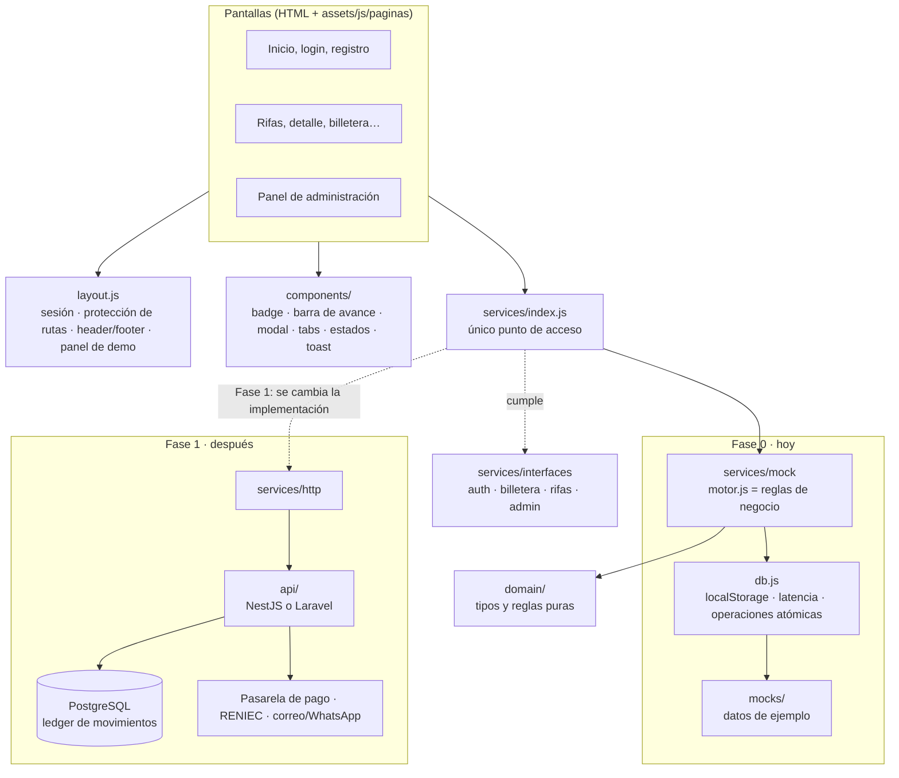

# Arquitectura

Las pantallas nunca saben de dónde vienen los datos: siempre pasan por los servicios. En la Fase 0 los servicios son simulados (mock); en la Fase 1 se reemplazan por servicios que llaman a la API, sin tocar las pantallas (README §3).

## Capas

| Capa | Qué es | Dónde vive |
|------|--------|------------|
| Visual | Cómo se ve: pantallas y componentes, con datos falsos | `assets/`, carpetas de cada pantalla (en Fase 1: `web/`) |
| Semántica | Qué significa: entidades, estados, acciones y reglas | README §7 y `docs/semantica/` |
| Funcional | Cómo funciona de verdad: API, base de datos, pagos | `api/` (Fase 1) |
