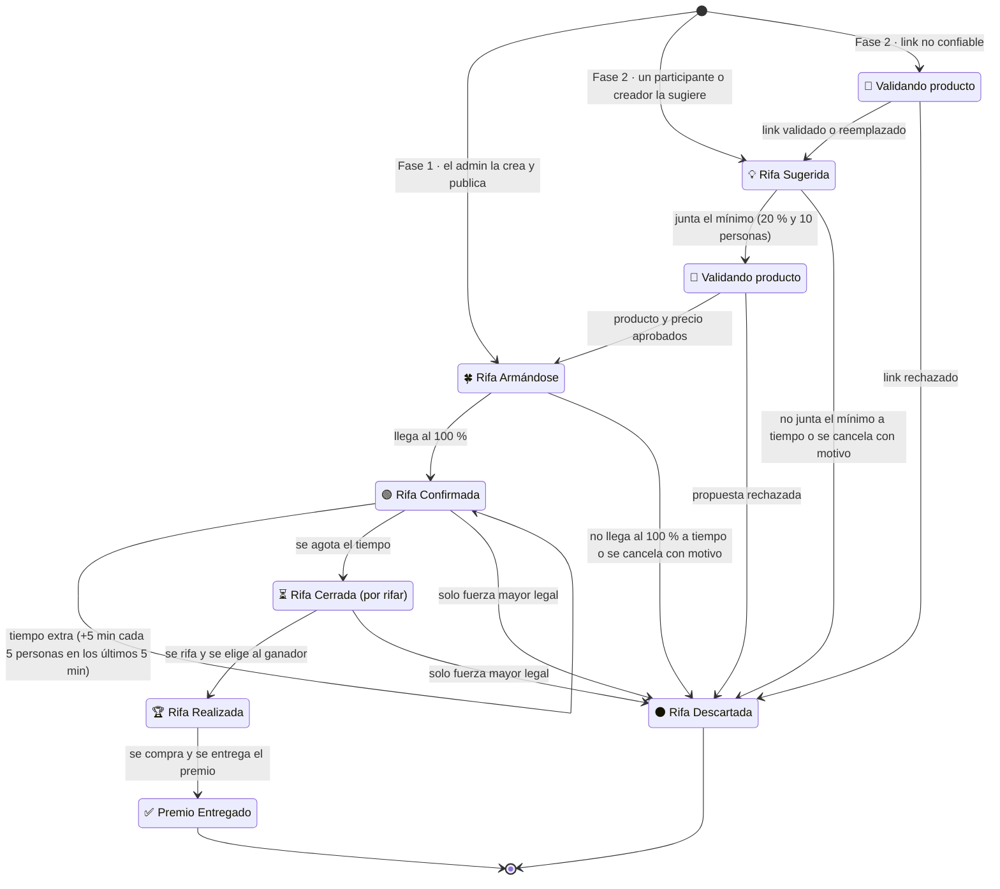
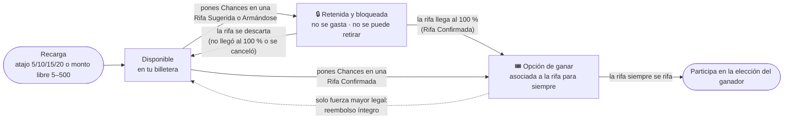
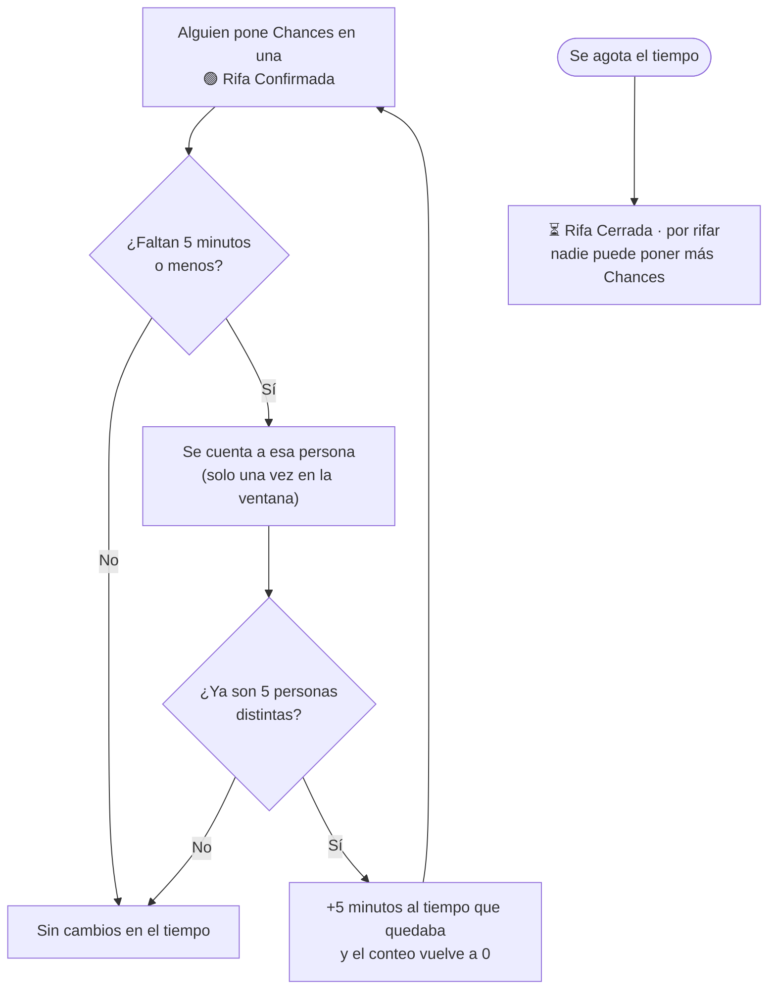
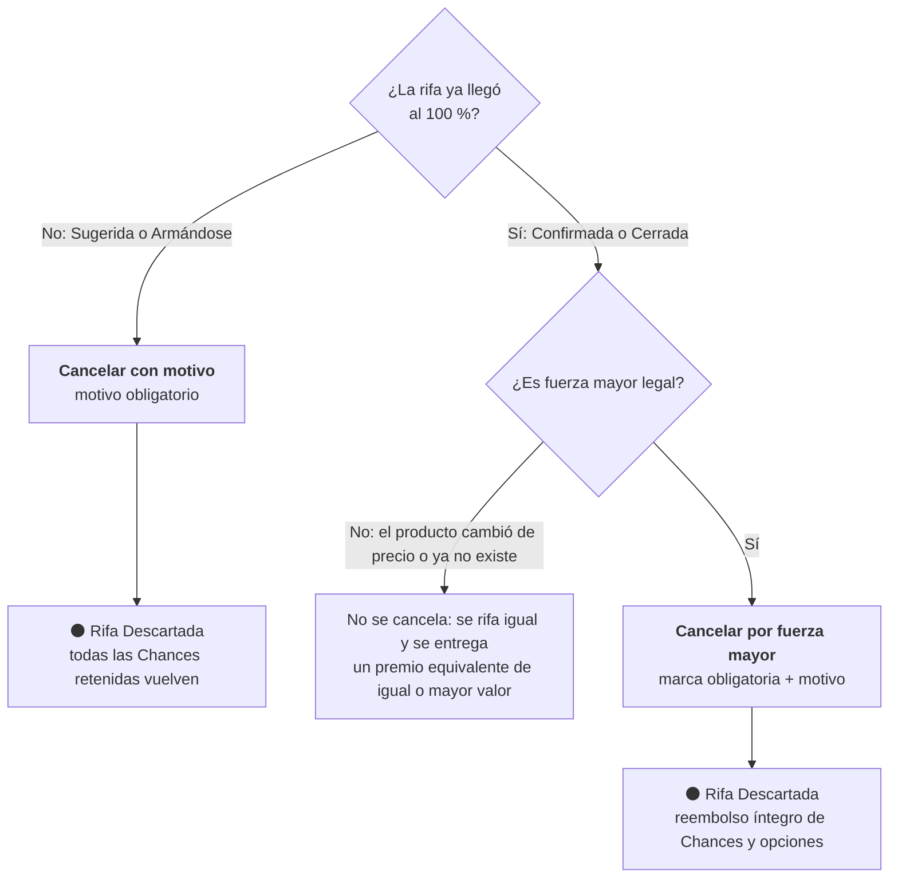

# Ciclo de vida de una rifa

Lo que ve el público (estados visibles), cómo se mueven las Chances, el tiempo extra y las dos formas de cancelar.
La especificación completa está en el README §7.4, §7.5 y §7.13.

## 1. Estados visibles

| Estado visible | Qué significa | ¿Recibe Chances? | Qué pasa con las Chances |
|----------------|---------------|------------------|--------------------------|
| 💡 **Rifa Sugerida** *(Fase 2)* | La sugiere un participante o creador; **quien la crea es responsable** de juntar el mínimo. Solo por enlace. | Sí | Quedan retenidas y bloqueadas |
| 🔎 **Validando producto** | El equipo revisa que el link sea confiable, que el producto exista y que el precio sea coherente. | No | Siguen retenidas |
| 🍀 **Rifa Armándose** | Visible en el portal; menos del 100 % de lo que necesita. | Sí | Quedan retenidas y bloqueadas |
| 🟢 **Rifa Confirmada** | Llegó al 100 %. Sigue abierta un tiempo, con tiempo extra al final. | Sí (compra directa) | Son opciones de ganar, para siempre |
| ⏳ **Rifa Cerrada** (por rifar) | Se agotó el tiempo. Lista congelada y huella publicada; se valida y se anuncia la fecha. | No | Son opciones de ganar |
| 🏆 **Rifa Realizada** | Ya se eligió al ganador; se compra y se envía el premio. | No | — |
| ✅ **Premio Entregado** | El premio llegó al titular del DNI ganador. | No | — |
| ⚫ **Rifa Descartada** | No llegó al 100 %, se canceló o la propuesta no pasó la validación. | No | Vuelven todas (o se reembolsan si fue fuerza mayor) |

## 2. Ciclo de las Chances

## 3. Tiempo extra al final de una Rifa Confirmada

*Ejemplo:* faltan 3 minutos y se unen 5 personas → ahora faltan 8 minutos. Las siguientes 5 personas suman otros 5 minutos, y así sucesivamente hasta que el tiempo se agote.

## 4. Cancelar una rifa

## 5. Estados internos

Cada estado interno se muestra al público con su estado visible.

| Estado visible | Estados internos |
|----------------|------------------|
| Rifa Sugerida | `CAPTANDO` |
| Validando producto | `REVISION_LINK`, `PROPUESTA` |
| Rifa Armándose | `ARMANDO` |
| Rifa Confirmada | `ABIERTA` |
| Rifa Cerrada | `CERRADA`, `EN_REVISION`, `PROGRAMADA` |
| Rifa Realizada | `SORTEADA`, `COMPRANDO`, `EN_CAMINO` |
| Premio Entregado | `ENTREGADA` |
| Rifa Descartada | `NO_SE_ARMO`, `CANCELADA`, `DESCARTADA` |
| *(no visible)* | `BORRADOR` |

El diagrama de estados internos, con todas sus transiciones, está en el README §7.4.
