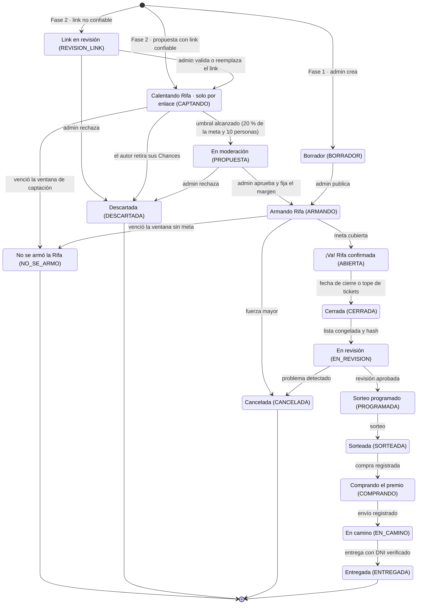

# Ciclo de vida de una rifa

Máquina de estados del README §7.4, con los nombres visibles actuales. Entre paréntesis, el estado interno.

## Qué pasa con las Chances en cada estado

| Estado | ¿Acepta Chances? | Efecto en la billetera |
|--------|------------------|------------------------|
| Calentando Rifa / Armando Rifa | Sí, como compromiso | Disponible → Retenido |
| ¡Va! Rifa confirmada | Sí, como compra directa | Retenido → Consumido · Disponible → Consumido |
| No se armó la Rifa / Descartada | No | Retenido → Disponible (liberación) |
| Cancelada | No | Retenido → Disponible y Consumido → Disponible (reembolso) |
| Resto | No | — |

La compra del premio se hace fuera de la web; COMPRANDO, EN_CAMINO y ENTREGADA solo registran cada paso (README §7.12).
