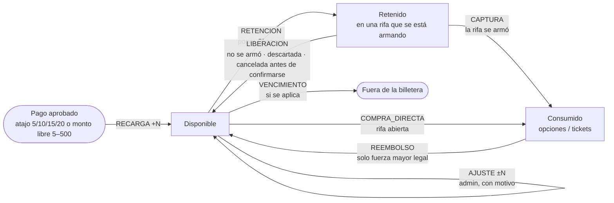
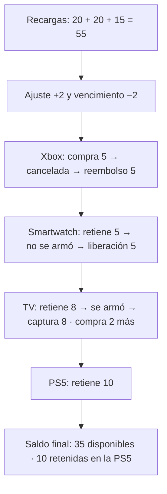

# Flujo de la billetera

Dónde está cada Chance en todo momento (README §7.7 y §7.10). Cada flecha es un **movimiento** inmutable del historial; el saldo siempre es la suma de los movimientos.

## Reglas que nunca se rompen

- Disponible y retenido **nunca** son negativos.
- Una Chance está en **un solo lugar** a la vez: disponible, retenida en una rifa o consumida en una rifa.
- Retenido = suma de los compromisos activos.
- Poner Chances o comprar lleva una **clave de idempotencia**: si la operación llega dos veces, se aplica una sola vez.
- Las Chances retenidas **no se pueden retirar**: vuelven solo si la rifa no se arma o se descarta.
- Una vez confirmada, la rifa **siempre se rifa**: las Chances quedan como opciones de ganar (solo hay reembolso por fuerza mayor legal).

## Ejemplo: Lucía (datos de demo)

