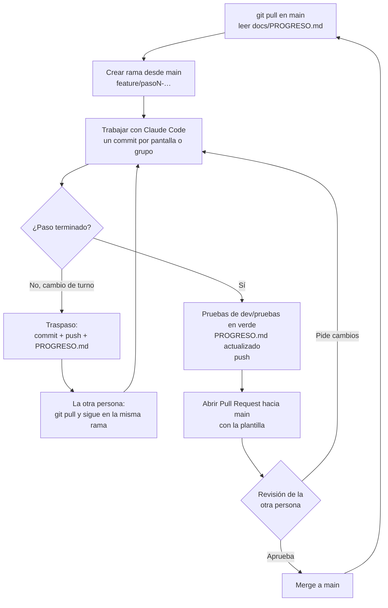
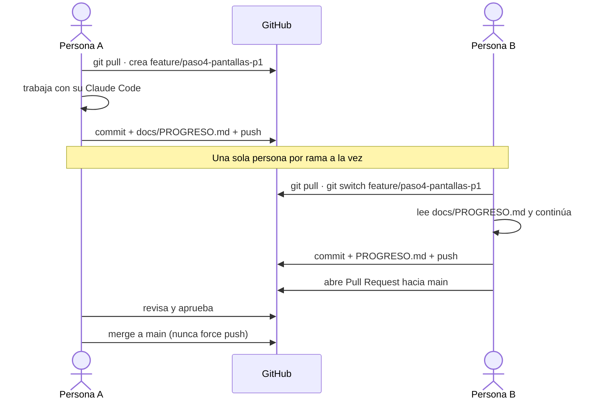

# Flujo de trabajo del equipo

Cómo avanza el proyecto: los pasos de [`PROMPT-FASE0.md`](../../PROMPT-FASE0.md), las ramas, los Pull Requests y el traspaso entre las dos personas del equipo. Las reglas completas están en [`CLAUDE.md`](../../CLAUDE.md) y en el README §12.

## Pipeline de pasos de la Fase 0

```mermaid
flowchart LR
    P0["Paso 0<br/>Reconocimiento"] --> P1["Paso 1<br/>Tokens y componentes"]
    P1 --> P2["Paso 2<br/>Dominio, datos y servicios mock"]
    P2 --> P3["Paso 3<br/>Navegación y layout"]
    P3 --> PR1{{"PR Pasos 0–3<br/>revisión y merge"}}
    PR1 --> P4["Paso 4<br/>Pantallas P1"]
    P4 --> P5["Paso 5<br/>Pantallas P2"]
    P5 --> P6["Paso 6<br/>Pantallas P3 (Fase 2)"]
    P6 --> P7["Paso 7<br/>Documentación semántica"]
    P7 --> P8["Paso 8<br/>Verificación final"]
    P8 --> F1(["Fase 1<br/>MVP funcional"])
```

Cada paso (o grupo de pantallas) va en su propia rama y entra a `main` por un Pull Request.

## Ciclo de una rama

## Traspaso entre personas

