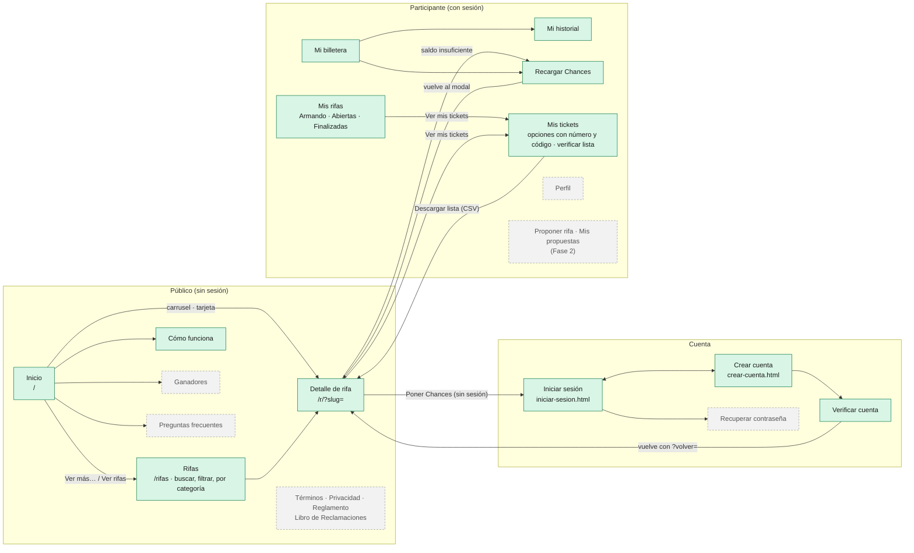
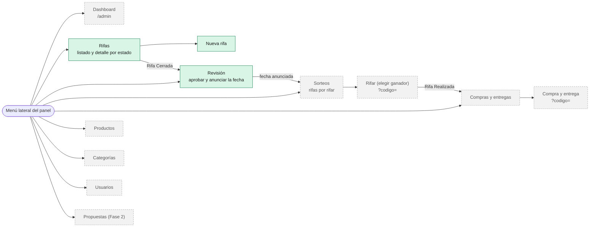

# Mapa de pantallas

Todas las pantallas del sitio y cómo se llega de una a otra. La fuente de verdad de rutas, nombres y accesos es [`assets/js/lib/rutas.js`](../../assets/js/lib/rutas.js); el inventario completo está en el README §6.

**Leyenda:** verde = ya construida · gris punteado = "En construcción" (Pasos 5 y 6).

## 1. Sitio público y cuenta

## 2. Panel de administración

El menú lateral sigue el orden fijado en `CLAUDE.md`.

