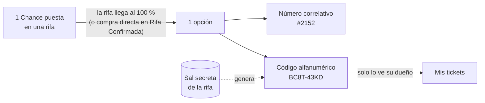
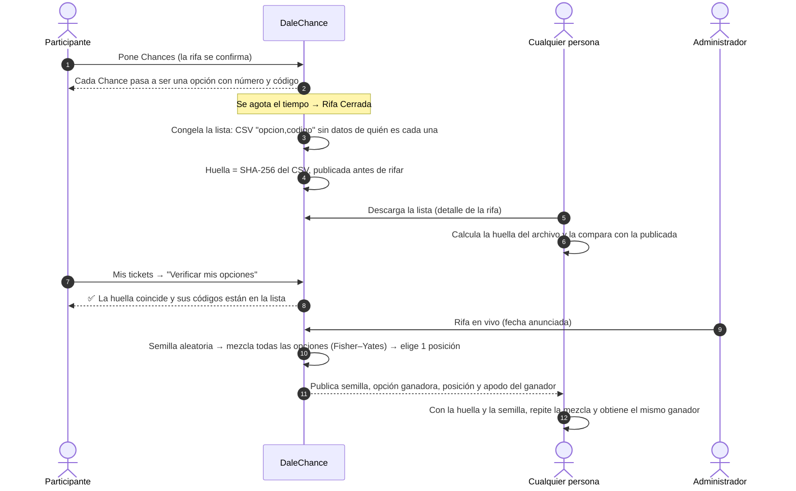
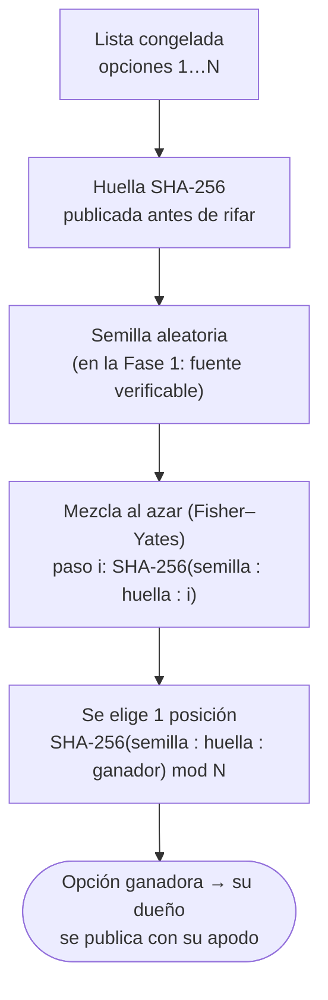

# Opciones, lista pública y elección del ganador

Cómo una Chance se convierte en una opción, cómo se publica la lista sin revelar de quién es cada opción, cómo cada persona verifica las suyas y cómo se elige al ganador. Especificación: README §7.8. Código: [`assets/js/domain/sorteo.js`](../../assets/js/domain/sorteo.js).

## 1. De Chance a opción

- 10 Chances = 10 opciones = 10 números y 10 códigos, todos asignados a la misma persona.
- El código usa letras y números sin caracteres confusos (sin 0/O, 1/I/L) y no se puede adivinar.

## 2. Publicación, verificación y elección del ganador

## 3. Cómo se elige al ganador

## Qué ve cada quien

| Dato | Público | Participante | Administrador |
|------|---------|--------------|---------------|
| Lista de opciones (número y código) | ✅ desde Rifa Cerrada | ✅ | ✅ |
| De quién es cada opción | ❌ | Solo las suyas | ✅ |
| Huella de la lista | ✅ | ✅ | ✅ |
| Semilla, opción ganadora y posición | ✅ al rifar | ✅ | ✅ |
| Apodo del ganador | ✅ al rifar | ✅ | ✅ |
| Sal secreta de la rifa | ❌ | ❌ | ❌ (solo el sistema) |
