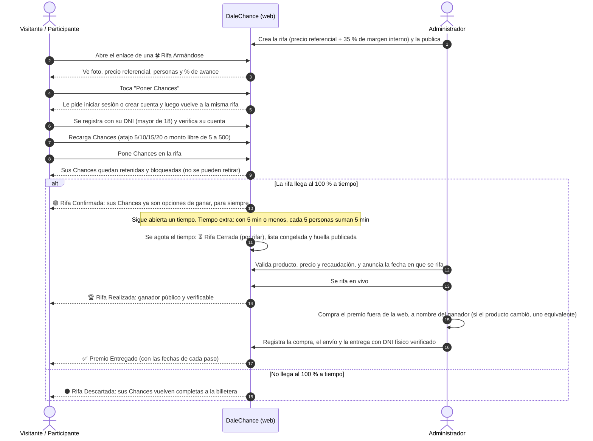

# Recorrido del usuario

De visitante a ganador, y qué hace el equipo de administración en cada etapa.

## Responsabilidades por etapa

| Etapa | Participante | Administrador |
|-------|--------------|---------------|
| Antes | — | Crea y publica la rifa (o valida rifas sugeridas en la Fase 2) |
| 💡 Rifa Sugerida *(Fase 2)* | Quien la sugiere comparte el enlace para juntar el mínimo | Valida el link y el producto |
| 🍀 Rifa Armándose | Pone Chances (quedan bloqueadas hasta que la rifa se confirme o se descarte) y comparte el enlace | Monitorea el avance; puede **cancelar con motivo** |
| 🟢 Rifa Confirmada | Pone más Chances (opciones de ganar); en los últimos 5 minutos su participación puede dar tiempo extra | Solo puede **cancelar por fuerza mayor legal** |
| ⏳ Rifa Cerrada | Espera la fecha en que se rifa | Valida, publica la fecha y la huella de la lista |
| 🏆 Rifa Realizada | Ve el ganador y cómo se eligió | Rifa en vivo; compra el premio fuera de la web |
| ✅ Premio Entregado | El ganador presenta su DNI físico | Registra envío y entrega con evidencia |
