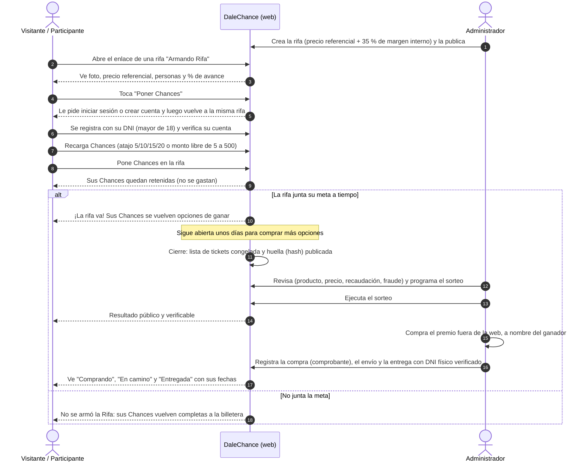

# Recorrido del usuario

De visitante a ganador, y qué hace el equipo de administración en cada etapa.

## Responsabilidades por etapa

| Etapa | Participante | Administrador |
|-------|--------------|---------------|
| Antes | — | Crea y publica la rifa (o modera propuestas en la Fase 2) |
| Armando Rifa | Pone Chances, comparte el enlace, puede retirar sus Chances | Monitorea el avance |
| ¡Va! (abierta) | Compra más opciones | — |
| Cerrada / En revisión | Espera | Revisa y programa el sorteo, o cancela con motivo (reembolso) |
| Sorteo | Ve el resultado | Ejecuta el sorteo verificable |
| Compra y entrega | Presenta su DNI físico | Compra fuera de la web y registra compra, envío y entrega |
