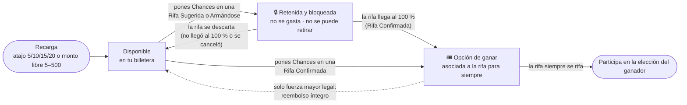

# Billetera: saldos, movimientos y garantías

> Parte de la **semántica funcional** (capa 2): [índice](README.md) · [README §7](../../README.md#7-semántica-funcional-definición-abstracta). Los números de sección (§7.x) se conservan del README para que las referencias del código y los documentos sigan valiendo.

Dónde está cada Chance en todo momento. Entidades **Billetera**, **Movimiento**, **Paquete de recarga** y **Recarga**, e invariantes 3–6 y 15–18, en [00-glosario.md](00-glosario.md).

## 7.7 Movimientos de billetera

| Tipo | Disponible | Retenido | Cuándo ocurre |
|------|-----------:|---------:|---------------|
| `RECARGA` | +N | 0 | Pago aprobado |
| `RETENCION` | −N | +N | Compromiso en rifa que capta o se arma |
| `LIBERACION` | +N | −N | La rifa no se armó, la propuesta se descartó o se canceló antes de confirmarse (no existe el retiro voluntario) |
| `CAPTURA` | 0 | −N | Rifa confirmada (meta cubierta) |
| `COMPRA_DIRECTA` | −N | 0 | Compra en rifa abierta |
| `REEMBOLSO` | +N | 0 | Cancelación de una rifa ya abierta |
| `AJUSTE` | ±N | 0 | Corrección manual de un admin, con motivo |
| `VENCIMIENTO` | −N | 0 | Puntos vencidos por inactividad (si se aplica) |

El participante ve estos movimientos en **Mi historial de puntos**, con la rifa asociada, para que siempre sepa dónde está cada punto: cuántos tiene libres, cuántos retenidos y en qué rifas, cuántos usó y cuántos le devolvieron.

## 7.10 Garantía de no duplicidad de puntos

Al poner puntos o comprar opciones, el sistema sigue siempre esta secuencia, como **una sola operación indivisible** (o se hace todo, o no se hace nada):

1. **Confirmación del participante:** pantalla de resumen con rifa, cantidad, saldo disponible antes y después. El botón se deshabilita al pulsarlo.
2. **Clave de idempotencia:** cada intento lleva un identificador único generado al abrir la confirmación. Si llega dos veces (doble clic, red lenta, reintento), la segunda se ignora y devuelve el mismo resultado.
3. **Bloqueo de la billetera:** mientras se procesa, ninguna otra operación del mismo participante puede tocar su saldo (bloqueo de fila).
4. **Revalidación en el servidor:** se vuelve a leer el saldo y el estado de la rifa en ese instante; lo que mostró la pantalla no cuenta.
5. **Movimiento + compromiso/tickets:** se registra el movimiento en el historial y el compromiso o los tickets, juntos.
6. **Verificación de cuadre:** disponible ≥ 0, retenido ≥ 0 y retenido = suma de compromisos activos (invariantes 16 y 17).
7. **Comprobante:** el participante recibe la confirmación con el número de operación, visible en **Mi historial de puntos**.

Además, un proceso diario de conciliación recorre todas las billeteras y alerta si algún saldo no coincide con su historial.

## 7.13 Estados visibles y tiempo extra (fragmento: ciclo de las Chances)

**Ciclo de las Chances**

- Desde la **Rifa Sugerida** hasta que la rifa se confirma o se descarta, las Chances quedan **retenidas y bloqueadas**: no se gastan y **no se pueden retirar** (invariante 23).
- Si la rifa **no llega al 100 %** (se descarta), vuelven **todas** a la billetera.
- Si **llega al 100 %**, se convierten en **opciones de ganar** y quedan asociadas a la rifa para siempre: **una Rifa Confirmada siempre se rifa** con quienes pusieron sus Chances (invariante 24).

## 7.9 Configuración (fragmento: recargas)

**Parámetros globales de recarga** (los define un admin; no son por rifa):

| Parámetro | Por defecto | Descripción |
|-----------|-------------|-------------|
| Atajos de recarga | 5, 10, 15 y 20 Chances | Recuadros rápidos en la pantalla de recarga |
| Recarga mínima | 5 Chances | Monto libre mínimo por recarga |
| Recarga máxima | 500 Chances | Monto libre máximo por recarga |

## 7.5 Acciones (comandos) y sus efectos (fragmento)

Cada acción tiene un **actor**, una **condición previa** y un **resultado**. Esta tabla es la que se implementará en la Fase 1 y la que los servicios mock simulan en la Fase 0.

| Acción | Actor | Condición previa | Resultado |
|--------|-------|------------------|-----------|
| Recargar puntos | Participante | Paquete activo | Recarga pendiente → al aprobarse el pago, disponible + N |

## 7.6 Eventos que el sistema comunica al participante (fragmento)

| Evento | Canal sugerido |
|--------|----------------|
| Recarga aprobada o rechazada | Correo + en pantalla |
| Puntos puestos en una rifa (retenidos) | En pantalla |
