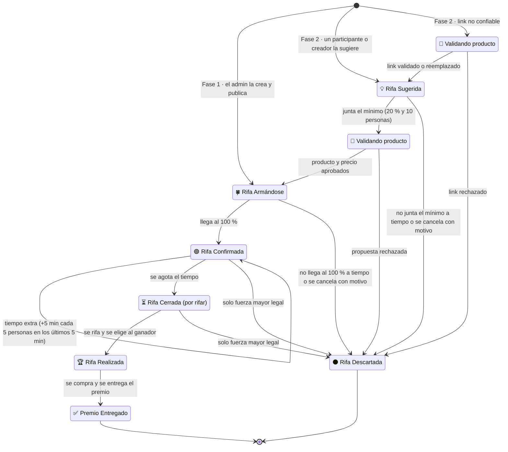
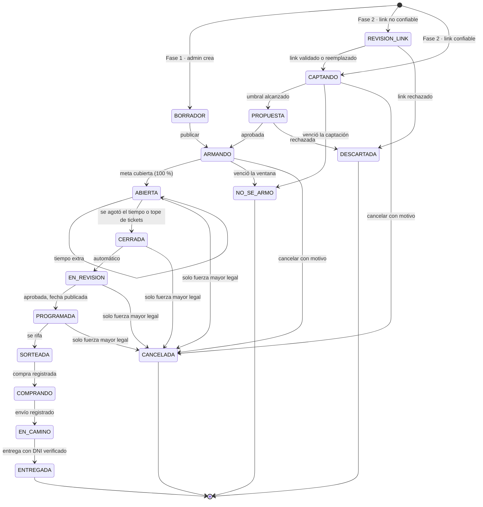
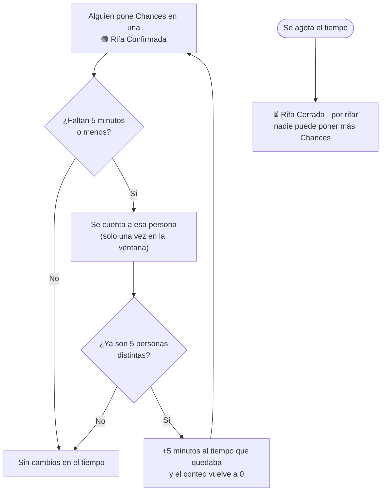

# Rifas: estados, transiciones y reglas

> Parte de la **semántica funcional** (capa 2): [índice](README.md) · [README §7](../../README.md#7-semántica-funcional-definición-abstracta). Los números de sección (§7.x) se conservan del README para que las referencias del código y los documentos sigan valiendo.

Cómo nace, se arma, se confirma y se cierra una rifa. Entidades **Rifa**, **Producto**, **Compromiso** y **Ticket**, e invariantes 7–10, 12, 14, 19–24, en [00-glosario.md](00-glosario.md). Las propuestas de la Fase 2 están en [05-propuestas.md](05-propuestas.md); las acciones del equipo, en [06-administracion.md](06-administracion.md).

## 7.4 Ciclo de vida de una rifa

**Lo que ve el público** (estados visibles, §7.13). Diagramas completos en [`docs/diagramas/ciclo-de-vida-rifa.md`](../diagramas/ciclo-de-vida-rifa.md).

**Estados internos** (los que usa el sistema; cada uno se muestra con su estado visible):

| Estado | Etiqueta visible | Significado | ¿Acepta puntos? | Efecto en saldo |
|--------|------------------|-------------|-----------------|-----------------|
| `BORRADOR` | — | El admin la está configurando; no es pública. | No | — |
| `REVISION_LINK` *(F2)* | Validando producto | El link no es de tienda confiable o no se pudo leer; un admin lo valida o lo reemplaza (§7.11). | No | — |
| `CAPTANDO` *(F2)* | **Rifa Sugerida** 🔒 | Propuesta privada, no listada. Su autor comparte el enlace y la gente que entra pone puntos. Si alcanza el umbral de visibilidad pasa a moderación. | Sí, como compromiso | Disponible → Retenido |
| `PROPUESTA` *(F2)* | Validando producto | Alcanzó el umbral; el admin valida producto lícito, precio coherente con el link y entregable, y fija el margen. Sigue accesible por enlace pero ya no acepta puntos nuevos. | No | Se mantiene retenido |
| `ARMANDO` | **Rifa Armándose** | Rifa pública que junta Chances hacia su meta durante la ventana de armado. Si se cubre la meta, se confirma y se abre automáticamente. | Sí, como compromiso | Disponible → Retenido |
| `NO_SE_ARMO` | **Rifa Descartada** | La ventana venció sin cubrir la meta. | No | Retenido → Disponible |
| `ABIERTA` | **Rifa Confirmada** | Meta cubierta. Todos los compromisos se convierten en tickets. Sigue abierta para nuevos participantes durante el tiempo configurado. | Sí, como compra directa | Retenido → Consumido · Disponible → Consumido |
| `CERRADA` | **Rifa Cerrada** · Por rifar | Se agotó el tiempo (incluido el tiempo extra, §7.13) o se llegó al tope de tickets. Lista congelada. Ya nadie puede poner Chances. | No | — |
| `EN_REVISION` | **Rifa Cerrada** · Por rifar | El admin verifica: producto disponible y a precio esperado, recaudación correcta, sin indicios de fraude. | No | — |
| `PROGRAMADA` | **Rifa Cerrada** · se rifa el *fecha* | Revisión aprobada; fecha y hora en que se rifa publicadas junto con el hash de la lista. | No | — |
| `SORTEADA` | **Rifa Realizada** · Ganador: *apodo* | Ganador seleccionado y notificado. | No | — |
| `COMPRANDO` | **Rifa Realizada** | La plataforma compra el producto **fuera de la web**, a nombre del ganador, y registra la compra (§7.12). | No | — |
| `EN_CAMINO` | **Rifa Realizada** | Producto enviado o listo para recojo. | No | — |
| `ENTREGADA` | **Premio Entregado** | Premio entregado al titular del DNI, con evidencia registrada (§7.12). Estado final. | No | — |
| `CANCELADA` | **Rifa Descartada** | Problema grave detectado en revisión (o fuerza mayor). | No | Consumido → Disponible (reembolso) |
| `DESCARTADA` *(F2)* | **Rifa Descartada** | Propuesta no aprobada en moderación. | No | Retenido → Disponible |

**Cambio respecto a la versión anterior:** la revisión de administradores ocurre **después del cierre** (no antes de abrir). Al cubrirse la meta, la rifa se confirma y se abre **automáticamente**. Ver la decisión pendiente #11 sobre una verificación rápida opcional antes de abrir.

## 7.13 Estados visibles y tiempo extra (fragmento: estados y tiempo extra)

El público ve **estados visibles**; cada uno agrupa estados internos que el equipo necesita para validar, revisar, comprar y entregar.

| Estado visible | Qué significa | Internos | ¿Visible en el portal? |
|----------------|---------------|----------|------------------------|
| **Rifa Sugerida** *(F2)* | Propuesta de un participante o creador. **Quien la crea es responsable** de juntar el apoyo mínimo para pasar al siguiente estado. | `CAPTANDO` | No: solo por su enlace |
| **Validando producto** | Estado de **validez**: el equipo revisa que el link sea confiable, que el producto exista y que el precio sea coherente. No recibe Chances nuevas. | `REVISION_LINK`, `PROPUESTA` | Solo por enlace |
| **Rifa Armándose** | Menos del 100 % de lo que necesita recaudar. | `ARMANDO` | Sí |
| **Rifa Confirmada** | Llegó al 100 %. Sigue abierta un tiempo (configurable por rifa) para que más personas se unan. | `ABIERTA` | Sí |
| **Rifa Cerrada** (por rifar) | Se agotó el tiempo: nadie puede poner más Chances. Lista congelada y hash publicado; se valida y se anuncia la fecha en que se rifa. | `CERRADA`, `EN_REVISION`, `PROGRAMADA` | Sí |
| **Rifa Realizada** | Ya se eligió al ganador. Mientras tanto se compra y se envía el premio (§7.12). | `SORTEADA`, `COMPRANDO`, `EN_CAMINO` | Sí |
| **Premio Entregado** | La administración compró el producto y lo entregó al titular del DNI. | `ENTREGADA` | Sí |
| **Rifa Descartada** | No llegó al 100 % a tiempo, se canceló por cualquier motivo (p. ej. el producto ya no existe) o la propuesta no pasó la validación. Todas las Chances vuelven. | `NO_SE_ARMO`, `CANCELADA`, `DESCARTADA` | Sí (en finalizadas) |

**Tiempo extra al final de una Rifa Confirmada**

1. Cuando a una Rifa Confirmada le quedan **5 minutos o menos**, se cuentan las **personas distintas** (no tickets) que ponen Chances en esa ventana.
2. Cada **5 personas** suma **5 minutos** al tiempo que quedaba. *Ejemplo:* faltan 3 minutos y se unen 5 personas → ahora faltan 8 minutos.
3. Las personas que ya sumaron no vuelven a contar; las siguientes 5 suman otros 5 minutos, y así sucesivamente.
4. Cuando el tiempo se agota, la rifa pasa automáticamente a **Rifa Cerrada** (por rifar).

Los tres valores (5 minutos, 5 personas, 5 minutos) son configurables por rifa (§7.9).

## 7.5 Acciones (comandos) y sus efectos (fragmento)

Cada acción tiene un **actor**, una **condición previa** y un **resultado**. Esta tabla es la que se implementará en la Fase 1 y la que los servicios mock simulan en la Fase 0.

| Acción | Actor | Condición previa | Resultado |
|--------|-------|------------------|-----------|
| Ver rifa | Visitante o participante | Rifa pública (desde ARMANDO en adelante) | Se muestra la información; si no hay sesión, el botón de acción lleva a login/registro y luego **regresa a la misma rifa** |
| Compartir rifa | Cualquiera | Rifa pública | Se copia o comparte su enlace (opcionalmente con código del creador para atribución) |
| Poner puntos (comprometer) | Participante | Rifa en CAPTANDO o ARMANDO, N ≤ disponible, dentro de límites, **confirmación explícita** y clave de idempotencia (§7.10) | Disponible − N, retenido + N, compromiso activo. **Si con esto se cubre la meta → la rifa se confirma** (ver "Confirmar rifa") |
| Comprar opciones | Participante | Rifa ABIERTA, N ≤ disponible, dentro de límites y del tope | Disponible − N, N tickets emitidos. Si se llega al tope → rifa CERRADA |
| Confirmar rifa | Sistema | Rifa en ARMANDO y meta cubierta | Captura de todos los compromisos en una sola operación, tickets emitidos, rifa ABIERTA |
| Declarar no armada | Sistema | Rifa en ARMANDO y ventana vencida sin meta | Liberación de todos los compromisos, rifa NO_SE_ARMO |
| Dar tiempo extra | Sistema | Rifa ABIERTA, faltan 5 min o menos y 5 personas distintas pusieron Chances en esa ventana (§7.13) | Cierre + 5 min; el conteo vuelve a 0 |
| Cerrar rifa | Sistema o admin | Rifa ABIERTA y (tiempo agotado, incluido el extra, o tope alcanzado) | Rifa CERRADA (visible: Rifa Cerrada · por rifar), snapshot y hash generados |

## 7.9 Configuración por rifa (solo administradores)

Cada rifa tiene parámetros propios con valores por defecto globales. Los participantes y creadores **no** pueden cambiarlos.

| Parámetro | Por defecto | Descripción |
|-----------|-------------|-------------|
| Margen | **35 % del precio del producto** | Porcentaje interno que se suma al precio para formar la meta. Ajustable por rifa |
| Ventana de armado | 7 días | Plazo para cubrir la meta |
| Tiempo abierta | 3 días | Cuánto sigue abierta tras confirmarse (rango sugerido: 2 a 7 días) |
| Tope de tickets | Sin tope | Al alcanzarse, la rifa se cierra antes de tiempo |
| Mínimo de puntos por participante | 1 | — |
| Máximo de puntos por participante | 20 % de la meta | Evita que una sola persona acapare |
| Mostrar avance | Personas + barra de % | Se muestra la cantidad de personas y una barra de 0–100 % (rojo → verde). Los montos, la meta y los puntos reunidos **no** se muestran |
| Categoría | — | Obligatoria |
| Umbral de visibilidad *(F2)* | **20 % de la meta total** (precio + margen), en puntos | Apoyo mínimo para salir de la etapa privada. Además exige un mínimo de **10 participantes** (decisión #22) |
| Ventana de captación *(F2)* | 7 días | Plazo de la etapa privada; la ventana de armado público empieza a contar al aprobarse |
| Puntos mínimos del autor *(F2)* | 1 % de la meta | El autor debe poner puntos propios en su propuesta |
| Propuestas activas por autor *(F2)* | 2 (creadores verificados: 5) | Evita spam de propuestas |
| Ventana de tiempo extra | 5 minutos | En una Rifa Confirmada, se activa cuando faltan estos minutos o menos (§7.13) |
| Personas por extensión | 5 personas distintas | Cada tantas personas (no tickets) que pongan Chances dentro de la ventana… |
| Minutos por extensión | 5 minutos | …suman estos minutos al tiempo que quedaba. Se repite hasta que el tiempo se agote |

### Ejemplo de cálculo de meta y umbral

| Concepto | Fórmula | PS5 (precio S/ 2,200) |
|----------|---------|----------------------:|
| Precio del producto | según el link de la tienda | 2,200 |
| Margen interno | 35 % × precio | 770 |
| **Meta total** | precio + margen | **2,970 puntos** |
| Umbral de visibilidad *(F2)* | 20 % × meta total | **594 puntos** |

- En **Rifa Sugerida** (privada), la propuesta necesita juntar 594 puntos para pasar a moderación y luego a **Rifa Armándose** (pública).
- En **Rifa Armándose**, necesita llegar a 2,970 puntos para que la rifa **vaya**.
- El público solo ve el precio del producto y la cantidad de participantes; la meta, el margen y el umbral son internos.
- El margen de 35 % sobre el precio equivale a ~26 % de la meta total. Si la rifa supera la meta mientras está abierta, el excedente se trata según la decisión #8.

## 7.11 Producto, link y garantía de entrega

**Título automático:** al pegar el link del producto, el sistema lee la página y toma su **título**, imagen principal, precio y una **descripción resumida** con los detalles básicos (si hay un color o modelo específico, va al inicio; si no es legible o no se encuentra, queda en blanco). Ese título es el nombre visible de la rifa. Un admin puede corregirlo si viene con texto basura (códigos, emojis, palabras de marketing).

**Validación del link:**

| Caso | Qué pasa |
|------|----------|
| Link de una **tienda confiable** (lista mantenida por los admins) y se pudo leer título, imagen y precio | La propuesta sigue su curso normal |
| Link de tienda desconocida, acortado (bit.ly y similares), con redirecciones raras, sin datos legibles o con precio fuera de rango | La propuesta pasa a **Link en revisión** (`REVISION_LINK`) y no recibe puntos hasta que un admin la valide |

**Reemplazo interno del link:** el admin puede cambiar el link de compra por uno equivalente en una tienda segura y adecuada, para **reflejar la intención** del autor y **garantizar la compra**. El link original se conserva en el historial; el público ve el producto, no necesariamente la tienda.

**Garantía de entrega:** la plataforma **no está obligada a entregar el producto exacto del link original**, pero **sí está obligada a entregar el premio rifado**: el mismo producto o uno equivalente de igual o mayor valor. Esto debe quedar escrito en los Términos y Condiciones y en el Reglamento de Rifas.

## 7.6 Eventos que el sistema comunica al participante (fragmento)

| Evento | Canal sugerido |
|--------|----------------|
| ¡Rifa Confirmada! Tus Chances ahora son opciones de ganar | Correo |
| Rifa Descartada: tus Chances volvieron a tu billetera | Correo |
| Rifa por vencer sin completar meta (recordatorio para compartir) | Correo |
