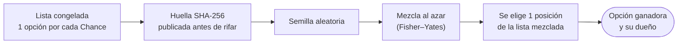

# Sorteo: lista congelada, selección y ganador

> Parte de la **semántica funcional** (capa 2): [índice](README.md) · [README §7](../../README.md#7-semántica-funcional-definición-abstracta). Los números de sección (§7.x) se conservan del README para que las referencias del código y los documentos sigan valiendo.

"Sorteo" nombra solo el acto técnico de elegir al ganador al azar; en los textos visibles se dice "se rifa", "Rifa en vivo" o "cómo se eligió al ganador". Entidades **Sorteo** y **Ganador** e invariante 8 en [00-glosario.md](00-glosario.md). Diagramas en [../diagramas/opciones-y-transparencia.md](../diagramas/opciones-y-transparencia.md).

## 7.8 Transparencia al elegir al ganador

1. Cada Chance que entra en una Rifa Confirmada se convierte en una **opción** con un **número** correlativo dentro de la rifa y un **código alfanumérico** (p. ej. `K7Q2-M9XD`, sin caracteres confusos). El código sale de una sal secreta de la rifa: no se puede adivinar, y solo su dueño lo ve en **Mis tickets**.
   Al pasar a **Rifa Cerrada** se congela la **lista pública de opciones** en un CSV (`opcion,codigo`), **sin datos de quién es cada opción**: nadie sabe qué opciones tienen los demás. Cualquiera puede descargarla desde el detalle de la rifa, y cada participante puede comprobar que sus códigos están en ella (botón "Verificar mis opciones" o buscando con Ctrl+F).
2. La huella publicada es el **SHA-256 del archivo CSV** y se **publica antes de rifar**. Para comprobarla: `certutil -hashfile opciones-RF-XXXX.csv SHA256` (Windows) o `shasum -a 256 opciones-RF-XXXX.csv` (Mac/Linux).
3. **Sorteo** (el acto técnico de elegir al ganador): cada Chance es una opción numerada. Antes de elegir, la lista completa de opciones se **mezcla al azar** ("se chocolatea", algoritmo Fisher–Yates), así las opciones de una misma persona no quedan juntas; después se elige **una posición** de la lista mezclada y gana la opción que está ahí.
4. La mezcla y la elección salen de una **semilla aleatoria** (en la Fase 1, de una fuente verificable como Random.org firmado o una semilla comprometida de antemano) y de la **huella publicada**: cada paso usa SHA-256(semilla : huella : paso). Implementación: `assets/js/domain/sorteo.js`.
5. Se publican la semilla, la opción ganadora y su posición en la lista mezclada: con la huella y la semilla, cualquiera puede repetir la mezcla y obtener el mismo ganador.

## 7.5 Acciones (comandos) y sus efectos (fragmento)

Cada acción tiene un **actor**, una **condición previa** y un **resultado**. Esta tabla es la que se implementará en la Fase 1 y la que los servicios mock simulan en la Fase 0.

| Acción | Actor | Condición previa | Resultado |
|--------|-------|------------------|-----------|
| Sortear | Admin | Rifa PROGRAMADA | Ticket ganador registrado, ganador notificado, rifa SORTEADA |

## 7.6 Eventos que el sistema comunica al participante (fragmento)

| Evento | Canal sugerido |
|--------|----------------|
| Fecha en que se rifa (fecha y hora) | Correo |
| Ganaste | Correo + WhatsApp |
| Rifa Realizada: resultado (para quienes no ganaron) | Correo |
