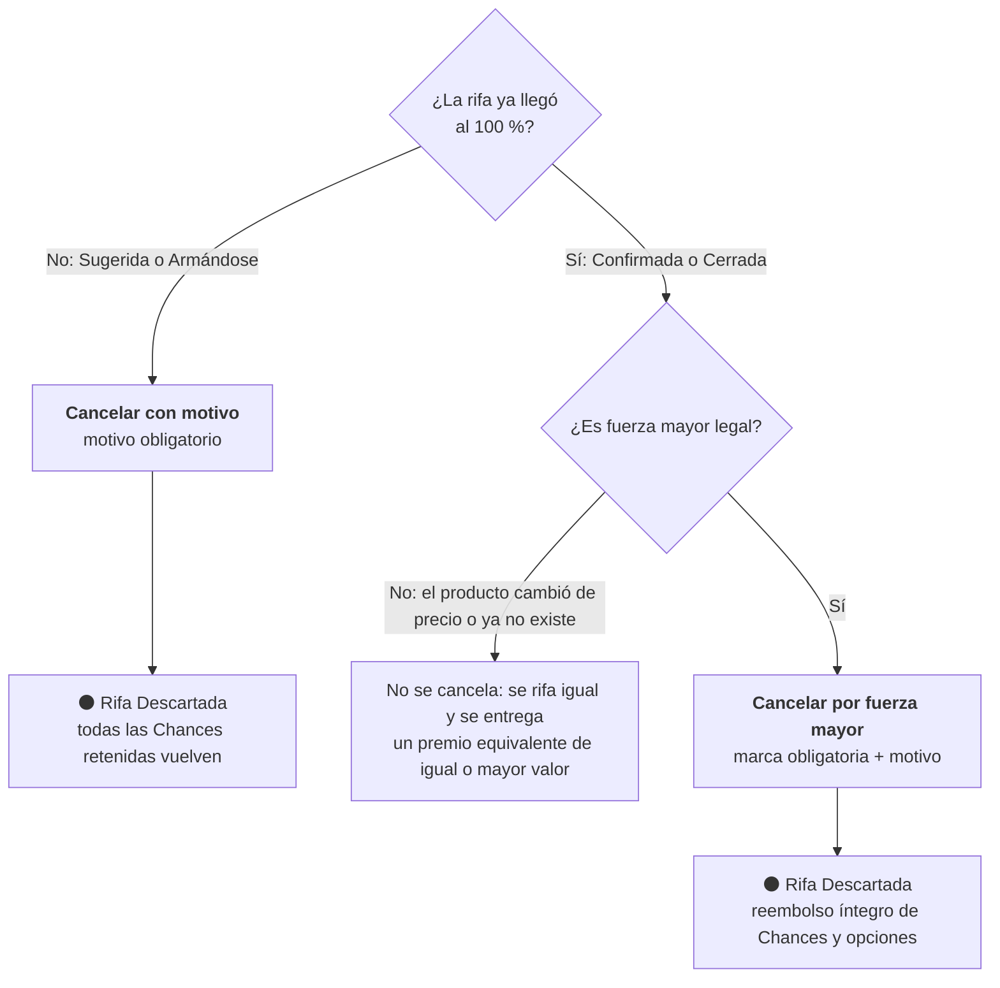

# Administración: revisión, cancelación y entrega del premio

> Parte de la **semántica funcional** (capa 2): [índice](README.md) · [README §7](../../README.md#7-semántica-funcional-definición-abstracta). Los números de sección (§7.x) se conservan del README para que las referencias del código y los documentos sigan valiendo.

Lo que hace el equipo de administración. Las acciones del panel siguen estas reglas; el panel muestra montos internos que el público nunca ve (invariante 12).

## 7.5 Acciones (comandos) y sus efectos (fragmento)

Cada acción tiene un **actor**, una **condición previa** y un **resultado**. Esta tabla es la que se implementará en la Fase 1 y la que los servicios mock simulan en la Fase 0.

| Acción | Actor | Condición previa | Resultado |
|--------|-------|------------------|-----------|
| Crear rifa | Admin | Producto con link, foto y precio; categoría | Rifa en BORRADOR con su configuración |
| Publicar rifa | Admin | Rifa en BORRADOR | Rifa en ARMANDO, ventana de armado inicia, enlace público activo |
| Aprobar revisión y anunciar la fecha | Admin | Rifa CERRADA → EN_REVISION, fecha en que se rifa definida | Rifa PROGRAMADA, fecha y hash públicos |
| Cancelar con motivo | Admin | Rifa que todavía no llega al 100 % (Sugerida o Armándose); motivo obligatorio | Liberación de todo lo retenido; rifa CANCELADA (visible: Rifa Descartada) |
| Cancelar por fuerza mayor | Admin | Rifa ya confirmada (Confirmada, Cerrada o con fecha para rifar), **solo por fuerza mayor legal**, marca de confirmación y motivo obligatorios (invariante 24) | Reembolso íntegro de todas las opciones; rifa CANCELADA (visible: Rifa Descartada) |
| Registrar compra | Admin | Rifa SORTEADA; datos de la compra y comprobante adjunto (§7.12) | Rifa COMPRANDO |
| Registrar envío | Admin | Rifa COMPRANDO; modalidad y fecha estimada (§7.12) | Rifa EN_CAMINO |
| Registrar entrega | Admin | Rifa EN_CAMINO; DNI físico verificado y evidencia adjunta (§7.12) | Rifa ENTREGADA |
| Ajustar saldo | Admin | Motivo obligatorio | Movimiento de ajuste registrado y auditado |

## 7.13 Estados visibles y tiempo extra (fragmento: cancelar una rifa)

**Cancelar una rifa**

En el panel de administración son dos botones distintos y cada uno aparece solo donde aplica: **Cancelar con motivo** (antes del 100 %) y **Cancelar por fuerza mayor** (ya confirmada).

## 7.12 Compra, envío y entrega del premio

La compra del premio **se hace fuera de la plataforma** (en la tienda, con los medios de pago de la empresa). La plataforma **no compra nada**: solo **registra** cada paso para gestión y control interno, y cada registro cambia el estado de la rifa.

| Registro | Estado | Datos obligatorios | Datos opcionales |
|----------|--------|--------------------|------------------|
| **Compra** | SORTEADA → COMPRANDO | Fecha de compra · tienda · monto pagado · número de boleta o factura · foto o PDF del comprobante · a nombre de quién se compró (nombres, apellidos y DNI del ganador) | Producto comprado (por defecto, el de la rifa) · si es **equivalente**, justificación obligatoria (igual o mayor valor, §7.11) |
| **Envío** | COMPRANDO → EN_CAMINO | Modalidad (**recojo en tienda** o **courier**) · fecha estimada · si es courier: empresa y código de seguimiento | — |
| **Entrega** | EN_CAMINO → ENTREGADA | Fecha · quién recibió · **DNI físico verificado: coincide con el titular** (invariante 11) · foto o acta de entrega | Observaciones |

- El premio se compra **a nombre del ganador**: sus datos salen de la cuenta ganadora, no se escriben a mano.
- Cada registro guarda automáticamente qué administrador lo hizo y cuándo.
- **Visibilidad:** los registros (comprobante, monto, datos del ganador, evidencia) son **solo para administradores**. La boleta lleva datos personales del ganador y no debe publicarse. El público ve únicamente el **estado** y la **fecha** de cada paso (comprado el…, enviado el…, entregado el…).

## 7.6 Eventos que el sistema comunica al participante (fragmento)

| Evento | Canal sugerido |
|--------|----------------|
| Rifa cancelada: puntos reembolsados | Correo |
| Premio comprado / en camino / entregado (para el ganador) | Correo + WhatsApp |
